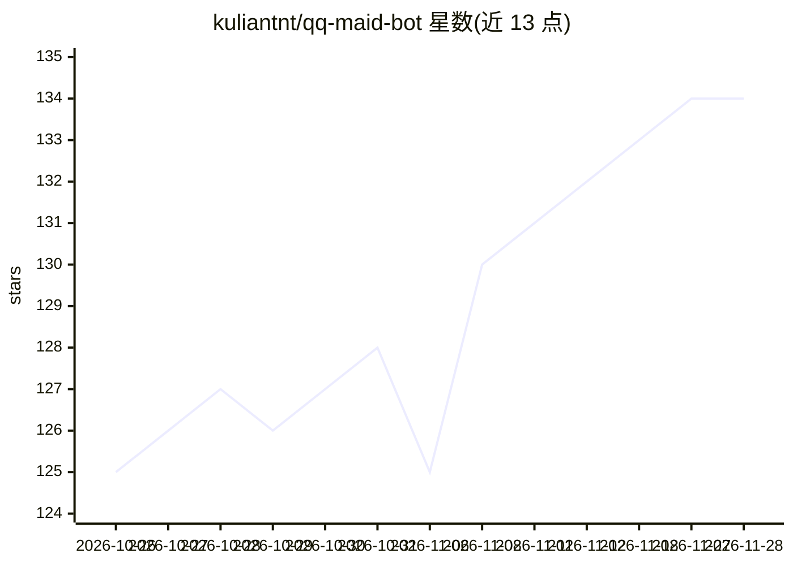

# kuliantnt/qq-maid-bot

⭐ 134 · Rust · MIT · 推送 2026-10-23 · [GitHub](https://github.com/kuliantnt/qq-maid-bot) · 个人维护 · 中文 README

**自托管多入口 AI Agent 聊天机器人：QQ/OneBot/微信接入，带记忆、RAG 与工具调用**

以 Rust 单进程实现的自托管 AI Agent 机器人，约 25 MiB 常驻内存，默认空闲 3 线程。在同一进程内提供多轮会话、受控长期记忆、Todo 与提醒、RSS 订阅推送、本地 Markdown 知识检索、联网搜索、图片理解与 Tool Calling。消息入口支持 QQ 官方机器人（主要入口）、OneBot 11（面向 NapCat）与可选微信服务号；模型层支持 OpenAI、Gemini、MiMo、DeepSeek 及 OpenAI-compatible Provider 并按候选链自动降级。安装提供 Linux/Windows 一键脚本、Docker Compose/GHCR 镜像和源码构建三条路径，配置经 Web Console 向导或 .env 完成。

## 筛选速览

| 维度 | 判定 | 备注 |
|---|---|---|
| AI 角色 | `ai-native` | 本体是模型或模型工具 |
| 许可风险 | `permissive` | MIT |
| 部署形态 | `desktop` | 安装包/桌面程序 |
| 模型依赖 | locked-api |  |
| 硬件要求 | — | 无带数字的原话,不猜 |
| 安装摩擦 | `low` | 无编译、无系统依赖或容器化 |
| 成熟度 | `idea` | |

## 能力要点

- Rust 单进程多入口架构：QQ 官方、OneBot 11（NapCat）、微信服务号三种消息入口
- 分域记忆管理（个人记忆、群内个人画像、群公共记忆）与本地 Markdown 知识库索引检索
- 受控 Tool Calling：仅服务端注册且按场景放行的工具可被模型调用，支持模型候选链自动降级
- 内置 DND/CoC 骰子命令、先攻表与本地周易起卦等娱乐功能

## 适用场景

- 在 QQ 群或私聊部署一个可记账、设提醒、查信息的自托管聊天机器人
- 通过 OneBot 11/NapCat 接入自建 QQ 协议端运行 Agent 服务
- 为群聊维护成员画像与公共记忆，并订阅 RSS 主动推送
- 跑团场景使用骰点、先攻表与 AI DM 功能

## 场景标签

`聊天机器人` · 领域:对话与助手

## 证据(README 行号)

> L3:  一个会聊天、会记事、会调用工具，也会主动推送的轻量、自托管、多入口 AI Agent 机器人。
> L12:  Rust 单进程 · 约 25 MiB 常驻内存 · 默认空闲时 3 个线程 · Provider 无关 Agent Loop · 多模态输入 · 主动推送 · 模型自动降级
> L174: - **多模型路由**：支持 OpenAI、Gemini、MiMo、DeepSeek 和 OpenAI-compatible Provider，并可按候选链自动降级。DeepSeek 新部署默认使用 V4 Flash Respo

## 星数曲线

2026-10-26 125 → 2026-11-28 134（+9）

---
*卡片 v1 · prompt 1.4 · 生成 2026-11-28 · 置信度 high · 依据 README sha `848dcb9d70c6` · [字段定义](../../DATASET.md)*
