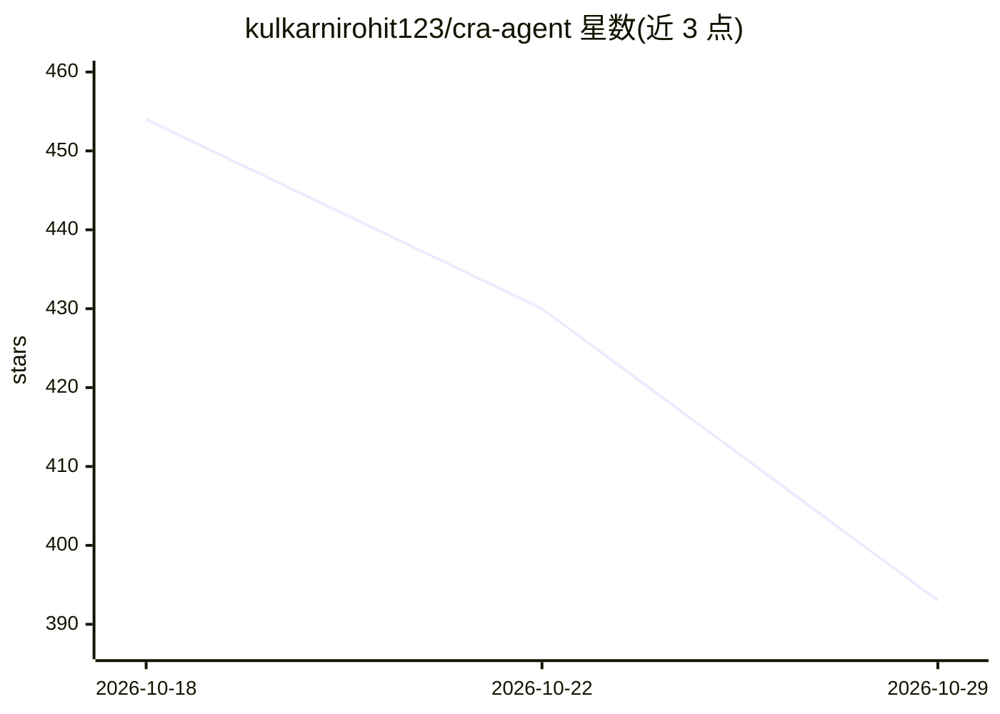

# kulkarnirohit123/cra-agent

⭐ 393 · Python · Apache-2.0 · 推送 2026-08-15 · [GitHub](https://github.com/kulkarnirohit123/cra-agent) · 个人维护

**面向 CRA 合规的自主 agent：扫描提交、分诊漏洞并自动修复**

用于持续 Cyber Resilience Act（欧盟网络弹性法案）合规监控的自主 agent 系统：检测新提交后提取变更，运行 semgrep/pip-audit/gitleaks 多类扫描器，LLM 进行严重度分诊并将发现映射到 CRA Annex I/Article 13 条款，自动创建和更新 Jira 工单；收到 Jira webhook 后可登记抑制规则或生成修复并开 PR。含 EUVD 每 4 小时同步与 Streamlit 实时监控面板。基于 LangGraph + LangChain 构建，LLM 后端 OpenAI/Anthropic 可插拔。Quick Start 标注为 planned（规划中），功能尚未完整交付。

## 筛选速览

| 维度 | 判定 | 备注 |
|---|---|---|
| AI 角色 | `ai-native` | 本体是模型或模型工具 |
| 许可风险 | `permissive` | Apache-2.0 |
| 部署形态 | `library` | 以包/库形式分发 |
| 模型依赖 | — | README 未给出锁定关系 |
| 硬件要求 | — | 无带数字的原话,不猜 |
| 安装摩擦 | `low` | 无编译、无系统依赖或容器化 |
| 成熟度 | — | 结构信号不足 |

## 能力要点

- 提交触发的多扫描器漏洞扫描与抑制规则过滤
- LLM 分诊严重度并映射 CRA Annex I/Article 13 条款
- Jira 工单自动化 + webhook 触发的抑制或自动修复开 PR
- EUVD 每 4 小时同步与 Streamlit 实时监控面板

## 适用场景

- DevSecOps 团队对每次提交做漏洞扫描与分诊
- 欧盟 CRA 合规要求的漏洞处理流程留痕（工单+映射条款）
- 通过 Jira 工单流转触发自动修复 PR

## 场景标签

`网络安全` · 领域:学习与行业

## 证据(README 行号)

> L7: An autonomous agentic AI system for continuous CRA compliance monitoring. It scans every commit, identifies vulnerab
> L80: - **AI-Powered Triage**: Uses LLMs to classify severity and recommend actions

## 星数曲线

2026-10-18 454 → 2026-10-29 393（-61）

---
*卡片 v1 · prompt 1.4 · 生成 2026-10-21 · 置信度 high · 依据 README sha `60cd35a71957` · [字段定义](../../DATASET.md)*
