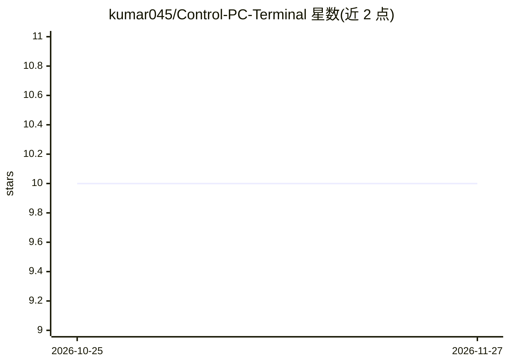

# kumar045/Control-PC-Terminal

⭐ 10 · Shell · MIT · 推送 2026-02-18 · [GitHub](https://github.com/kumar045/Control-PC-Terminal) · [官网](https://v0-control-terminal-docs.vercel.app) · 个人维护

**从手机经 Telegram/Web 远程控制桌面 AI CLI agent**

一个开源远程控制工具：将在桌面或 VPS 上运行的 CLI AI agent（Claude Code、Codex 或自定义 agent）放入 tmux 会话保持运行，通过 Telegram Bot 实时发送提示、流式查看输出、发送中断与确认命令；同时经 ttyd 提供浏览器 Web 终端，可选 cloudflared 隧道实现外网访问。安装脚本一行命令完成，支持 Linux，Windows 走 WSL。自身不产出模型输出，职责是桥接用户与已运行的 agent。

## 筛选速览

| 维度 | 判定 | 备注 |
|---|---|---|
| AI 角色 | `ai-ecosystem` | LLM/agent 周边工具 |
| 许可风险 | `permissive` | MIT |
| 部署形态 | `None` |  |
| 模型依赖 | — | README 未给出锁定关系 |
| 硬件要求 | — | 无带数字的原话,不猜 |
| 安装摩擦 | `low` | 无编译、无系统依赖或容器化 |
| 成熟度 | — | 结构信号不足 |

## 能力要点

- Telegram Bot 远程控制：/watch 流式输出、/interrupt 中断、/prompt 发送提示
- tmux 会话保证 agent 在断网或关闭浏览器后继续运行
- ttyd 提供浏览器 Web 终端，cloudflared 可选公网隧道
- custom-agents.conf 自定义任意终端 agent（stdin/stdout 协议）

## 适用场景

- 手机上远程查看并干预正在跑的长任务 coding agent
- 网络中断后 agent 任务不中断，回来自动续接
- 在 VPS 上托管 agent 并通过 Telegram 随时下发指令

## 场景标签

`编码 Agent` · 领域:编码与开发

## 证据(README 行号)

> L7: **Control-PC-Terminal** is an open-source tool that lets you control **Claude Code**, **Codex**, or **any custom CLI
> L9: Unlike standard remote tools, this is built for **AI Agent persistence**. Your agents run inside `tmux` sessions, so

## 星数曲线

2026-10-25 10 → 2026-11-27 10（+0）

---
*卡片 v1 · prompt 1.4 · 生成 2026-11-19 · 置信度 high · 依据 README sha `3b1c323295c5` · [字段定义](../../DATASET.md)*
