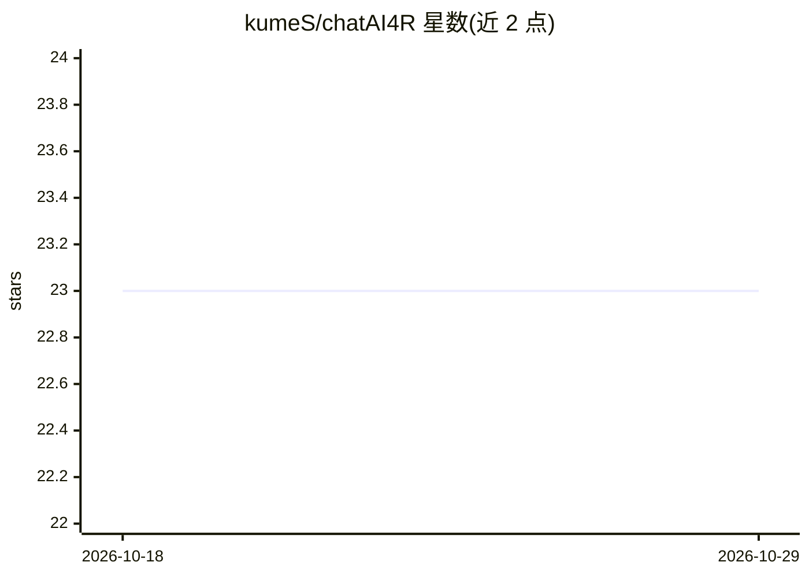

# kumeS/chatAI4R

⭐ 23 · HTML · Artistic-2.0 · 推送 2026-01-31 · [GitHub](https://github.com/kumeS/chatAI4R) · [官网](https://kumes.github.io/chatAI4R/) · 个人维护

**R 语言的 LLM 接口与工作流包：聊天、统计分析解读与包开发辅助**

chatAI4R 是一个 R 包，封装 OpenAI、Google Gemini、io.net、Replicate、Dify、DeepL 六类 AI 服务的 API，提供 54 个函数、按 4 层架构组织：核心 API 访问（chat4R/gemini4R/multiLLMviaionet）、任务函数（统计结果解读、摘要、校对）、工作流函数（多 agent 讨论、R 函数自动生成）与集成函数（plumber 部署、GUI）。面向 R 包开发者与数据分析师，需配置 API key（OpenAI 为多数函数必需），含 52 函数的自动化测试。

## 筛选速览

| 维度 | 判定 | 备注 |
|---|---|---|
| AI 角色 | `ai-ecosystem` | LLM/agent 周边工具 |
| 许可风险 | `viral` | Artistic-2.0 |
| 部署形态 | `None` |  |
| 模型依赖 | — | README 未给出锁定关系 |
| 硬件要求 | — | 无带数字的原话,不猜 |
| 安装摩擦 | `low` | 无编译、无系统依赖或容器化 |
| 成熟度 | `idea` | |

## 能力要点

- 支持 OpenAI/Gemini/io.net/Replicate/Dify/DeepL 六类 AI 服务
- 54 个函数按 4 层架构组织（API 访问→任务→工作流→集成）
- interpretResult 覆盖 13+ 领域的统计结果 AI 解读
- multiLLMviaionet 可同时比较 io.net 上 23+ 模型

## 适用场景

- 用 R 控制台直接调用多个 LLM 服务做对话与摘要
- 让 AI 解读回归等统计分析结果、处理文献
- 自动生成带 Roxygen2 文档的 R 函数、解释报错

## 场景标签

`多智能体` `数据分析` `代码生成` · 领域:Agent 开发

## 证据(README 行号)

> L16: **chatAI4R**, **Chat-based Interactive Artificial Intelligence for R**, is an R package designed to integrate the O
> L39: **Layer 1 - Core Functions**: Direct API access (`chat4R`, `gemini4R`, `multiLLMviaionet`)

## 星数曲线

2026-10-18 23 → 2026-10-29 23（+0）

---
*卡片 v1 · prompt 1.4 · 生成 2026-10-27 · 置信度 high · 依据 README sha `2c2766c3415e` · [字段定义](../../DATASET.md)*
