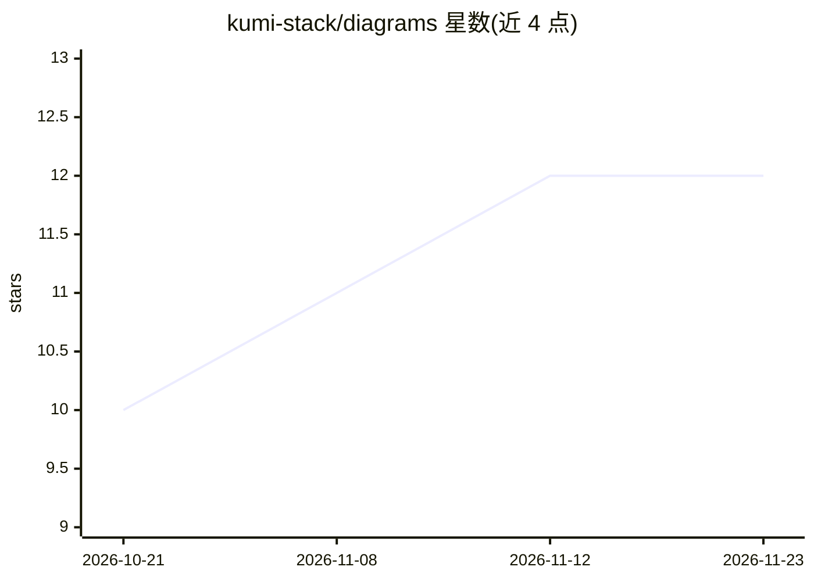

# kumi-stack/diagrams

⭐ 12 · Svelte · GPL-3.0 · 推送 2026-09-02 · [GitHub](https://github.com/kumi-stack/diagrams) · 组织维护

**面向开发者的本地 Mermaid 图表桌面编辑器，可配 Ollama 本地 AI**

KumiDiagrams 是基于 SvelteKit、Tauri 与 Rust 后端的桌面应用，用于创建和组织 Mermaid 图表。图表以 .mmd 纯文本文件存储在项目文件夹中，支持文件树管理、实时预览渲染、语法错误提示、四类图表的编辑器自动补全、外观配置与 PNG 导出。可选集成 Ollama 本地模型，从文字描述生成初始 Mermaid 源码，数据不发送到外部服务。提供 macOS DMG 安装包，也可从源码运行，源码方式需要 Node.js、pnpm、Rust/Cargo 及 Tauri 2 系统依赖。

## 筛选速览

| 维度 | 判定 | 备注 |
|---|---|---|
| AI 角色 | `ai-enhanced` | 去掉 AI 部分产品仍成立 |
| 许可风险 | `viral` | GPL-3.0 |
| 部署形态 | `desktop` | 安装包/桌面程序 |
| 模型依赖 | local-ok | 支持本地模型 |
| 硬件要求 | — | 无带数字的原话,不猜 |
| 安装摩擦 | `low` | 无编译、无系统依赖或容器化 |
| 成熟度 | — | 结构信号不足 |

## 能力要点

- 实时预览渲染与即时语法错误提示的 Mermaid 编辑器
- 四类图表（流程图/时序图/状态图/ER 图）自动补全
- 可选 Ollama 本地 AI 从描述生成初始 Mermaid 源码
- 图表以纯文本 .mmd 文件存储，可纳入 Git 与跨机器迁移

## 适用场景

- 以文件夹为单位管理项目的架构与流程图
- 在离线/隐私要求环境下用本地模型生成图表草稿
- 将图表作为纯文本文件纳入 Git 版本管理

## 场景标签

`代码生成` · 领域:编码与开发

## 证据(README 行号)

> L3: KumiDiagrams is a desktop application for creating and organizing Mermaid diagrams. It combines SvelteKit, Tauri, an
> L16: - **Optional local AI** - Ollama integration can generate initial Mermaid source from a description without sending

## 星数曲线

2026-10-21 10 → 2026-11-23 12（+2）

---
*卡片 v1 · prompt 1.4 · 生成 2026-11-18 · 置信度 high · 依据 README sha `926c2c74bb56` · [字段定义](../../DATASET.md)*
