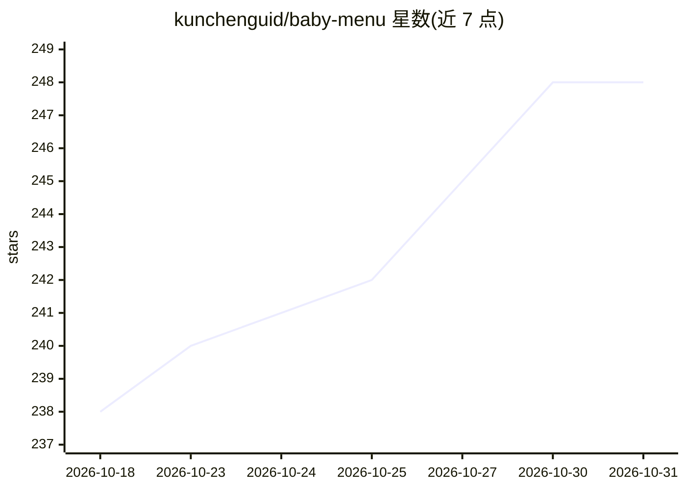

# kunchenguid/baby-menu

⭐ 248 · TypeScript · MIT · 推送 2026-10-22 · [GitHub](https://github.com/kunchenguid/baby-menu) · 个人维护

**可被 AI agent 用自然语言实时改造的 macOS 菜单栏应用**

基于 Electron 的 macOS 菜单栏应用：内置弹窗可调用已认证的编码 agent CLI（如 claude、codex），用户用自然语言提出需求，agent 编写扩展并热重载进菜单栏，实现 CPU 占用、Claude 用量等自定义小部件。每轮改动基于 git/快照 diff 呈现 Keep/Undo，可保留或撤销。本体是菜单栏小部件应用，AI agent 是其扩展生成机制；要求 macOS 13+、Homebrew 及 PATH 上的 agent CLI。

## 筛选速览

| 维度 | 判定 | 备注 |
|---|---|---|
| AI 角色 | `ai-enhanced` | 去掉 AI 部分产品仍成立 |
| 许可风险 | `permissive` | MIT |
| 部署形态 | `None` |  |
| 模型依赖 | locked-api |  |
| 硬件要求 | — | 无带数字的原话,不猜 |
| 安装摩擦 | `low` | 无编译、无系统依赖或容器化 |
| 成熟度 | — | 结构信号不足 |

## 能力要点

- 自然语言请求由编码 agent 生成扩展并热重载进菜单栏
- 每轮改动基于真实 git/快照 diff 提供 Keep/Undo
- 内置 Claude Code、Codex、Cursor、GitHub Copilot、Grok 的配额 recipe
- 扩展、数据库、缓存与偏好统一存于 ~/.baby-menu

## 适用场景

- 在菜单栏组合自己需要的小部件（如 CPU 占用+Claude 用量+日程）
- 用自然语言随时增改菜单栏功能，不满意可撤销
- 查看各家编码 agent 的配额状态

## 场景标签

 · 领域:桌面工具/AI agent 应用

## 证据(README 行号)

> L22: The popover menu can run your coding agent to edit the menu on the fly.
> L23: You ask for a feature in plain English, the agent writes an extension and it hot reloads into the menu in real time
> L26: - **Ask, don't configure** - tweak the menu using natural language, not configuration.

## 星数曲线

2026-10-18 238 → 2026-10-31 248（+10）

---
*卡片 v1 · prompt 1.4 · 生成 2026-10-22 · 置信度 high · 依据 README sha `b1108bfa9c26` · [字段定义](../../DATASET.md)*
