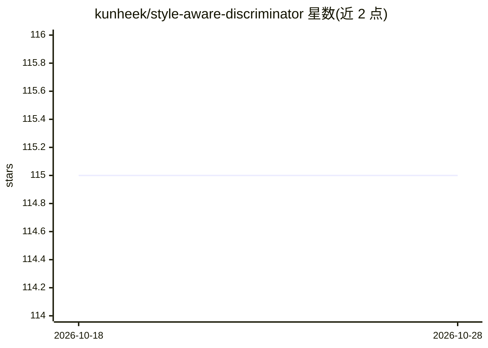

# kunheek/style-aware-discriminator

⭐ 115 · Python · MIT · 推送 2026-07-07 · [GitHub](https://github.com/kunheek/style-aware-discriminator) · [官网](https://arxiv.org/abs/2203.15375) · 组织维护

**CVPR 2022 论文官方实现：风格感知判别器的可控图像翻译 PyTorch 代码**

POSTECH 团队发布的 CVPR 2022 论文 "A Style-Aware Discriminator for Controllable Image Translation" 官方 PyTorch 实现。判别器同时充当 critic 与风格编码器，通过原型自监督学习构建可控风格空间并指导生成器，支持风格插值、内容移植与局部图像翻译等任务。提供 8 个预训练 checkpoint（HuggingFace 下载）、FID/LPIPS 等评测指标、合成脚本与训练脚本。当前实现（2025）改用纯 Python 版 StyleGAN2 算子，训练/推理速度下降且与原论文数值不完全一致；原文精确复现需 PyTorch 1.10-1.13 与 CUDA 11.2-11.3。推荐单张 A100 级 GPU 训练，多卡 DDP 存在性能退化。

## 筛选速览

| 维度 | 判定 | 备注 |
|---|---|---|
| AI 角色 | `ai-native` | 本体是模型或模型工具 |
| 许可风险 | `permissive` | MIT |
| 部署形态 | `library` | 以包/库形式分发 |
| 模型依赖 | — | README 未给出锁定关系 |
| 硬件要求 | — | 无带数字的原话,不猜 |
| 安装摩擦 | `medium` | 含编译或系统依赖之一 |
| 成熟度 | — | 结构信号不足 |

## 能力要点

- 风格感知判别器：critric + 风格编码器，原型自监督学习可控风格空间
- 支持风格插值、内容移植、局部翻译等合成任务
- 8 个预训练模型可经 download.py 从 HuggingFace 下载
- 提供 FID/KID/LPIPS 等评测与 t-SNE 风格空间可视化工具

## 适用场景

- 复现论文或基于预训练模型做可控图像翻译实验
- 在 AFHQ/CelebA-HQ/FFHQ 等数据集上训练图像翻译模型
- 分析学到的风格空间（t-SNE 可视化、相似样本检索）

## 场景标签

`图像生成` · 领域:内容生成

## 证据(README 行号)

> L10: > **Abstract:** *Current image-to-image translations do not control the output domain beyond the classes used durin
> L24: **Current Implementation (2025):**

## 星数曲线

2026-10-18 115 → 2026-10-28 115（+0）

---
*卡片 v1 · prompt 1.4 · 生成 2026-10-23 · 置信度 mid · 依据 README sha `1e055b5d5599` · [字段定义](../../DATASET.md)*
