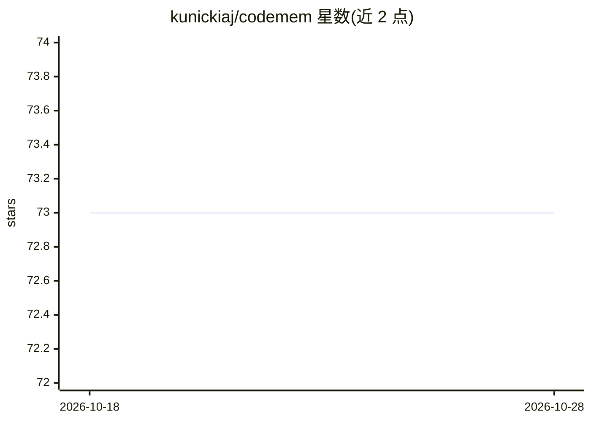

# kunickiaj/codemem

⭐ 73 · TypeScript · MIT · 推送 2026-10-27 · [GitHub](https://github.com/kunickiaj/codemem) · [官网](https://codemem.sh) · 个人维护

**为 OpenCode/Claude Code 等编码代理提供跨会话持久记忆**

面向 OpenCode、Claude Code、Codex 与 Pi 编码代理的持久记忆工具：捕获编码过程中的决策、失败路径与仓库特定陷阱，存入本地 SQLite，通过 FTS5 BM25 与 sqlite-vec 语义检索混合召回并自动注入后续提示词。支持 P2P 同步在多机与队友间共享项目记忆，多代理共享同一项目级存储，并内置本地 Web 查看器与可选 OAuth 保护的远程 MCP 端点。限制：观察者处理使用配置的模型提供商，会产生费用；OpenCode 2 集成标注为 beta；语义运行时固定 CPU 推理，Intel Mac 在语义初始化失败时降级为关键词检索。

## 筛选速览

| 维度 | 判定 | 备注 |
|---|---|---|
| AI 角色 | `ai-ecosystem` | LLM/agent 周边工具 |
| 许可风险 | `permissive` | MIT |
| 部署形态 | `library` | 以包/库形式分发 |
| 模型依赖 | — | README 未给出锁定关系 |
| 硬件要求 | — | 无带数字的原话,不猜 |
| 安装摩擦 | `low` | 无编译、无系统依赖或容器化 |
| 成熟度 | `idea` | |

## 能力要点

- FTS5 BM25 + sqlite-vec 混合检索与重排序，自动向代理注入上下文
- 本地优先 SQLite 存储，支持 P2P 跨机同步与队友共享
- OpenCode/Claude Code/Codex/Pi 多代理共享一个项目级记忆库
- 内置本地 Web 查看器与 OAuth 保护的 Streamable HTTP MCP 远程端点

## 适用场景

- 让编码代理在新会话中自动回忆此前的决策与仓库陷阱
- 跨多台机器和队友同步项目记忆
- 浏览与审计代理捕获的会话与观察者输出

## 场景标签

`Agent 记忆` · 领域:Agent 开发

## 证据(README 行号)

> L18: codemem is persistent coding memory across sessions, machines, and teammates for OpenCode, Claude Code, Codex, and 
> L21: - **Optional sync and sharing** — peer-to-peer sync carries selected project memory across machines; share project 
> L26: - **Multi-agent** — OpenCode, Claude Code, Codex, and pi share one project-scoped store

## 星数曲线

2026-10-18 73 → 2026-10-28 73（+0）

---
*卡片 v1 · prompt 1.4 · 生成 2026-10-24 · 置信度 high · 依据 README sha `a57de832423c` · [字段定义](../../DATASET.md)*
