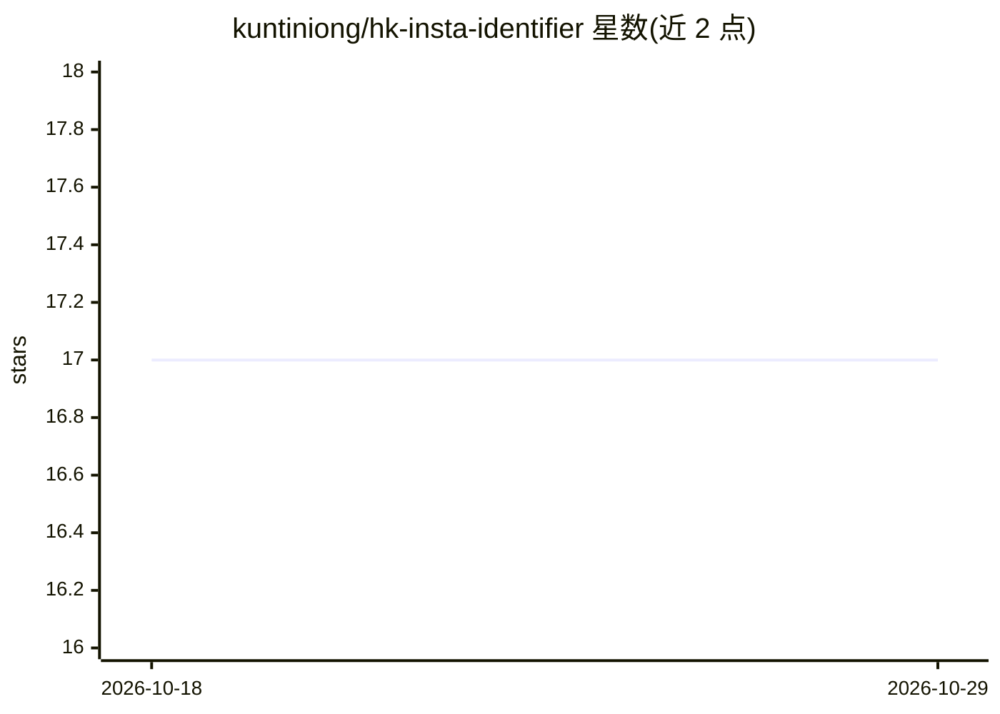

# kuntiniong/hk-insta-identifier

⭐ 17 · Jupyter Notebook · MIT · 推送 2026-04-13 · [GitHub](https://github.com/kuntiniong/hk-insta-identifier) · [官网](https://hk-insta-identifier.streamlit.app) · 个人维护

**基于罗马化粤语音节特征识别香港 Instagram 用户的二分类项目**

端到端 NLP 实验项目：用 Selenium 从 hypeauditor.com 采集原始用户名，借助 NLTK 音节分词器从无空格、非标准英文的用户名中提取音节特征（独立元音簇、辅音簇、音节总数等），再用 Logistic Regression、Random Forest、SVM 做香港/非香港用户的二分类。GridSearchCV 下 LR 与 SVM 测试结果为 0.742，RF 为 0.691。作者自述为大一年级实验性项目，无语言学专业背景；README 列出私营账户、英文名、方言罗马化重叠等局限。提供 Streamlit 在线试用。

## 筛选速览

| 维度 | 判定 | 备注 |
|---|---|---|
| AI 角色 | `ai-native` | 本体是模型或模型工具 |
| 许可风险 | `permissive` | MIT |
| 部署形态 | `None` |  |
| 模型依赖 | — | README 未给出锁定关系 |
| 硬件要求 | — | 无带数字的原话,不猜 |
| 安装摩擦 | `low` | 无编译、无系统依赖或容器化 |
| 成熟度 | `idea` | |

## 能力要点

- 仅凭用户名的罗马化粤语语音模式做二分类，不依赖 Meta 用户元数据
- NLTK 音节分词器提取音节特征（元音簇/辅音簇/音节数）
- 对比 LR/RF/SVM 三种传统模型，最佳测试结果 0.742
- 提供 Streamlit 在线试用页面

## 适用场景

- 研究用户名中的罗马化粤语语音模式是否足以识别香港用户
- 学习针对无空格短文本的音节级特征工程方法
- 复现一个小型端到端文本分类实验流程

## 场景标签

`网页抓取` · 领域:效率与自动化

## 证据(README 行号)

> L3: NLP pipeline that identifies Hong Kong Instagram users solely based on Romanized Cantonese phonetic patterns in user
> L9: This binary classification project aims to identify Hong Kong Instagram users **without relying on real-time users' 
> L13: Since usernames are not complex and the goal is creating a lightweight bot, simpler traditional models like **Logis

## 星数曲线

2026-10-18 17 → 2026-10-29 17（+0）

---
*卡片 v1 · prompt 1.4 · 生成 2026-10-29 · 置信度 high · 依据 README sha `d05c9c5c1134` · [字段定义](../../DATASET.md)*
