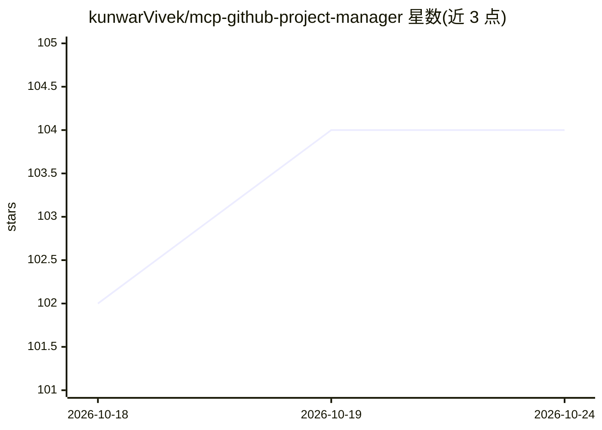

# kunwarVivek/mcp-github-project-manager

⭐ 104 · TypeScript · MIT · 推送 2026-10-20 · [GitHub](https://github.com/kunwarVivek/mcp-github-project-manager) · [官网](https://github.com/kunwarVivek/mcp-github-project-manager#readme) · 个人维护

**面向 AI 编码代理的 GitHub 项目管理 MCP 服务器**

实现 Model Context Protocol 的服务器，把 GitHub Projects v2 变成 AI 代理的自主项目管理层：代理注册、原子领取任务、心跳监控、互相评审，全部状态存于 GitHub（issues/项目字段/评论），无需外部数据库。提供 20 个复合工具共 169 个动作，覆盖 PRD 生成、任务分解、冲刺规划、triage、Actions/Releases/分支保护等 GitHub API 操作，并支持按角色配置多家 AI 提供商；无 AI key 时非 AI 工具仍可用。供 Claude Code、Cursor、Codex 等 MCP 客户端调用。

## 筛选速览

| 维度 | 判定 | 备注 |
|---|---|---|
| AI 角色 | `ai-ecosystem` | LLM/agent 周边工具 |
| 许可风险 | `permissive` | MIT |
| 部署形态 | `self-host` | docker 或自建部署 |
| 模型依赖 | local-ok | 支持本地模型 |
| 硬件要求 | — | 无带数字的原话,不猜 |
| 安装摩擦 | `low` | 无编译、无系统依赖或容器化 |
| 成熟度 | — | 结构信号不足 |

## 能力要点

- 20 个复合工具暴露 169 个动作，含 MCP Resources/Prompts/Sampling
- 代理注册、原子领取、心跳监控、按代理 token 预算与失效恢复
- PRD→任务→Issues→里程碑→冲刺的生成管线
- 全部状态存于 GitHub，零外部基础设施

## 适用场景

- 给 Claude Code/Cursor 等编码代理提供任务骨干与多代理协作底座
- 用 AI 从项目想法生成 PRD 并拆解为 GitHub issues 与冲刺
- 监控代理群的任务进度、工作产品与 token 消耗

## 场景标签

`多智能体` · 领域:Agent 开发

## 证据(README 行号)

> L3: **The agentic task substrate for AI coding agents.** An MCP server that turns GitHub Projects v2 into a fully autono
> L13: This MCP server implements the Model Context Protocol to provide a complete **agentic project management layer** ov
> L41: |**Custom harnesses**|Any MCP-compatible client — see `examples/basic/agent-loop.ts`|

## 星数曲线

2026-10-18 102 → 2026-10-24 104（+2）

---
*卡片 v1 · prompt 1.4 · 生成 2026-10-23 · 置信度 high · 依据 README sha `898b61cc787d` · [字段定义](../../DATASET.md)*
