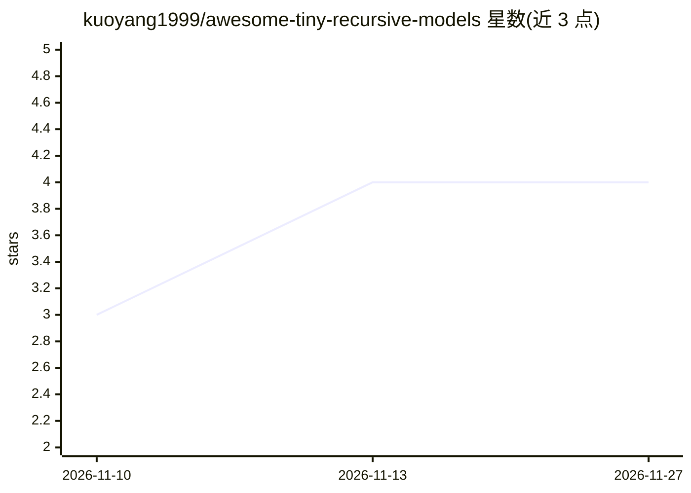

# kuoyang1999/awesome-tiny-recursive-models

⭐ 4 · Python · CC0-1.0 · 推送 2026-11-16 · [GitHub](https://github.com/kuoyang1999/awesome-tiny-recursive-models) · 个人维护

**递归推理模型（TRM/HRM）论文与基准的编目清单**

收录 Tiny Recursive Model、Hierarchical Reasoning Model 及更广递归推理模型家族的论文、代码仓库、基准与结果表格，共 533 篇论文、16 个仓库、95 条带协议标注的结果，按核心谱系、算子与状态设计等类别组织。每条结果附带评测协议（pass@1/pass@2、测试时增强等），并明确提示不要跨协议排序；对使用标准 LLM 的迭代方法仅设边界章节收录。面向研究该模型家族的读者。

## 筛选速览

| 维度 | 判定 | 备注 |
|---|---|---|
| AI 角色 | `ai-knowledge` | 知识聚合/清单类 |
| 许可风险 | `viral` | CC0-1.0 |
| 部署形态 | `None` |  |
| 模型依赖 | — | README 未给出锁定关系 |
| 硬件要求 | — | 无带数字的原话,不猜 |
| 安装摩擦 | `low` | 无编译、无系统依赖或容器化 |
| 成熟度 | — | 结构信号不足 |

## 能力要点

- 533 篇论文、95 条带协议标注的结果，按类别组织
- 收录 TRM、HRM 及直接后继模型的核心谱系
- 每条结果标注评测协议，声明不可跨协议排名
- 明确收录范围：权重绑定的迭代网络，排除 agent 循环

## 适用场景

- 查找 TRM/HRM 类递归推理模型的原始论文与代码
- 了解 ARC-AGI、Sudoku-Extreme 等基准上的已发表结果
- 跟踪该模型家族的新论文与会议评审状态

## 场景标签

`精选清单` · 领域:学习与行业

## 证据(README 行号)

> L10: > **What belongs here.** A *recursive reasoning model* (RRM) applies one small set of weights again and
> L48: |Date|Paper|Venue / status|Links|TL;DR|

## 星数曲线

2026-11-10 3 → 2026-11-27 4（+1）

---
*卡片 v1 · prompt 1.4 · 生成 2026-11-21 · 置信度 high · 依据 README sha `9ac8bb4d8d8d` · [字段定义](../../DATASET.md)*
