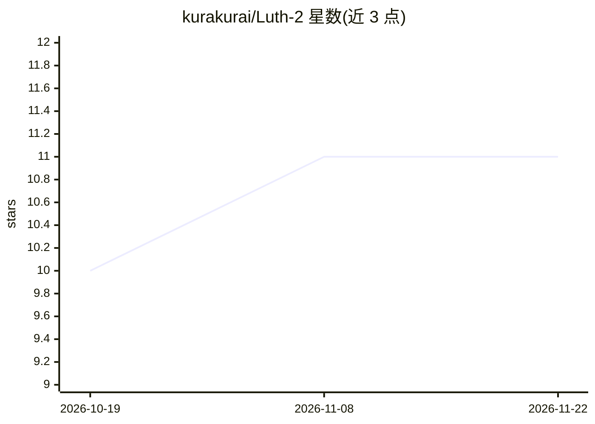

# kurakurai/Luth-2

⭐ 11 · Python · 推送 2026-08-11 · [GitHub](https://github.com/kurakurai/Luth-2) · 组织维护

**面向法语的小模型后训练训练/评测复现代码**

Luth-2 模型的训练、评测与数据处理复现代码库：基于 Qwen3.5，包含 3B token 多领域 SFT（TRL SFTTrainer + DeepSpeed ZeRO-3）、GRPO 强化学习（prime-rl + vLLM 推理）与多教师 on-policy 蒸馏（MOPD）四类配方，另提供法语基准评测（fork 的 lm-evaluation-harness）、模型合并（mergekit）及数据去污染/去重流程。各阶段依赖冲突，需分别创建环境；需要 uv 与 CUDA GPU。发布 0.8B/2B 两个模型。

## 筛选速览

| 维度 | 判定 | 备注 |
|---|---|---|
| AI 角色 | `ai-native` | 本体是模型或模型工具 |
| 许可风险 | `none` | — |
| 部署形态 | `None` |  |
| 模型依赖 | local-ok | 支持本地模型 |
| 硬件要求 | — | 无带数字的原话,不猜 |
| 安装摩擦 | `high` | 编译与系统依赖俱全 |
| 成熟度 | — | 结构信号不足 |

## 能力要点

- SFT/RL/MOPD 三阶段训练配方，含 GRPO 奖励环境与多教师蒸馏
- 法语评测任务集（MGSM-re2、Multi-IF 等）基于 lm-evaluation-harness fork
- 数据去污染（n-gram 重叠）与去重（MinHash-LSH）流水线
- 各阶段以 make 命令驱动，支持自定义 YAML 配置

## 适用场景

- 复现或继续法语小模型的后训练
- 在法语基准上评测和对比模型
- 构建法语 SFT/RL 训练数据并做去污染

## 场景标签

`模型评测` `强化学习` `微调` · 领域:评测与运维

## 证据(README 行号)

> L5: **Luth-2** is the second iteration of our French post-training work, built on Qwen3.5 with a 3B-token multi-domain S
> L22: Supervised fine-tuning with TRL's `SFTTrainer`,

## 星数曲线

2026-10-19 10 → 2026-11-22 11（+1）

---
*卡片 v1 · prompt 1.4 · 生成 2026-11-18 · 置信度 high · 依据 README sha `eae32c55a4e3` · [字段定义](../../DATASET.md)*
