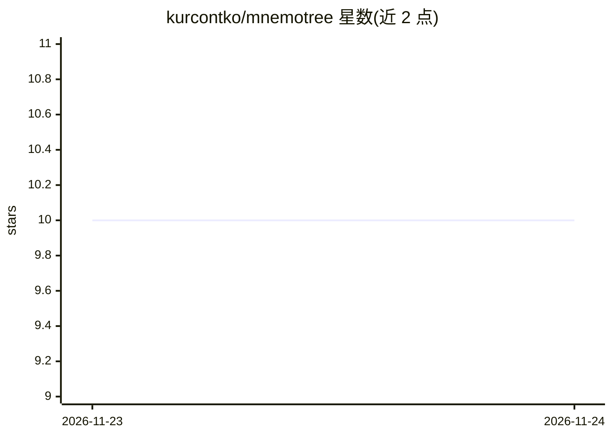

# kurcontko/mnemotree

⭐ 10 · Python · MIT · 推送 2026-11-24 · [GitHub](https://github.com/kurcontko/mnemotree) · [官网](https://pypi.org/project/mnemotree/) · 个人维护

**为 LLM 代理提供本地 SQLite 记忆存储与检索模块**

基于 SQLite、FTS5 与 sqlite-vec 的代理记忆模块：原文保存每条消息，检索时返回带出处片段而非改写摘要。混合检索用 FTS5 BM25 与向量余弦、RRF 融合，可选重排；证据按精确 token 预算打包并输出 trace；读写按 namespace 隔离且单事务提交。提供 Python 库、MCP 服务器（stdio）与 HTTP 服务三种使用方式；默认安装仅依赖 Pydantic、sqlite-vec 与 tiktoken。0.4.0 起移除旧 MemoryCore 与可插拔后端。

## 筛选速览

| 维度 | 判定 | 备注 |
|---|---|---|
| AI 角色 | `ai-ecosystem` | LLM/agent 周边工具 |
| 许可风险 | `permissive` | MIT |
| 部署形态 | `library` | 以包/库形式分发 |
| 模型依赖 | — | README 未给出锁定关系 |
| 硬件要求 | — | 无带数字的原话,不猜 |
| 安装摩擦 | `low` | 无编译、无系统依赖或容器化 |
| 成熟度 | — | 结构信号不足 |

## 能力要点

- 原文保存与带出处片段召回，不做摘要改写
- FTS5 BM25 + sqlite-vec 余弦经 RRF 融合的混合检索
- 证据按精确 token 预算打包并记录候选 trace
- 同库提供 Python API、MCP 服务器与 HTTP 服务

## 适用场景

- 给本地运行的 LLM 代理添加可溯源的长期记忆
- 通过 MCP 让 Claude Desktop/Claude Code 接入共享记忆库
- 按 namespace 隔离多用户/多会话的记忆数据
- 自托管记忆检索 HTTP 服务供后端调用

## 场景标签

`Agent 记忆` · 领域:Agent 开发

## 证据(README 行号)

> L3: Local, source-first memory for LLM agents: SQLite, FTS5 and sqlite-vec.
> L108: `mnemotree-mcp` gives Claude Code, Claude Desktop, Codex and other MCP clients the

## 星数曲线

2026-11-23 10 → 2026-11-24 10（+0）

---
*卡片 v1 · prompt 1.4 · 生成 2026-11-23 · 置信度 high · 依据 README sha `e5d8ef0a31a6` · [字段定义](../../DATASET.md)*
