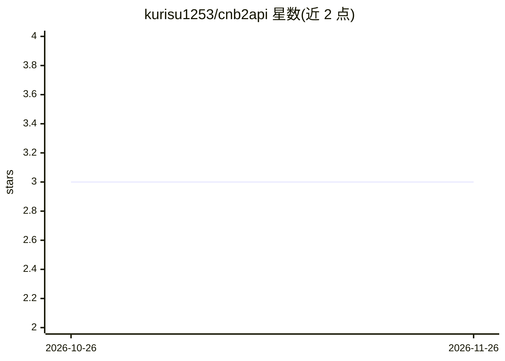

# kurisu1253/cnb2api

⭐ 3 · JavaScript · MIT · 推送 2026-10-27 · [GitHub](https://github.com/kurisu1253/cnb2api) · 个人维护 · 中文 README

**把 CNB 云工作区内部 AI 端点转成 OpenAI 兼容 API 的网关**

运行在 CNB 云开发工作区内的代理服务：将仅限内网访问的 AI 补全端点封装为公开的 OpenAI 与 Anthropic 双协议 API，支持 SSE 流式、工具调用透传与用量统计（/usage 与 quota CLI 面板）。依赖 CNB 发放的组织免费 AI Credits 与计算时长配额。通过 v5.2 双看门狗架构（内部 cron 恢复、外部 VPS watchdog、动态子域名注册到 Nginx 中继）应对容器每日回收与 cron 休眠。零外部依赖，仅用 Node.js 22+ 原生模块。本仓库为 dengyie/cnb2api 的镜像。

## 筛选速览

| 维度 | 判定 | 备注 |
|---|---|---|
| AI 角色 | `ai-ecosystem` | LLM/agent 周边工具 |
| 许可风险 | `permissive` | MIT |
| 部署形态 | `library` | 以包/库形式分发 |
| 模型依赖 | — | README 未给出锁定关系 |
| 硬件要求 | — | 无带数字的原话,不猜 |
| 安装摩擦 | `low` | 无编译、无系统依赖或容器化 |
| 成熟度 | — | 结构信号不足 |

## 能力要点

- OpenAI（/v1/chat/completions）与 Anthropic（/v1/messages）双协议，支持 SSE 流式与工具调用透传
- 零外部依赖，基于 Node.js 22+ 原生 fetch/ReadableStream 实现
- v5.2 双看门狗自愈：cron 恢复、动态域名注册、外部 VPS watchdog
- 终端 CLI 配额面板与 /usage 按代际分组的用量端点

## 适用场景

- 在 CNB 云工作区里为常用 OpenAI 客户端和聊天应用提供统一 API 入口
- 让 Claude Code CLI 通过 Anthropic 协议直连该网关
- 接入 New API / One API 等网关作为 OpenAI 渠道
- 用 CLI 面板随时查看剩余 Credits 与消耗

## 场景标签

`模型网关` · 领域:Agent 开发

## 证据(README 行号)

> L19: > **TL;DR**: CNB grants verified orgs **500 ~ 1,166 AI Credits** and **1,600 compute core-hours** monthly for free.
> L43:  - **OpenAI Compatible**: `/v1/chat/completions` and `/v1/models`, supporting SSE streaming and faithful non-stream
> L44:  - **Anthropic Compatible**: `/v1/messages` and `/v1/messages/count_tokens`, enabling **Claude Code CLI direct conn

## 星数曲线

2026-10-26 3 → 2026-11-26 3（+0）

---
*卡片 v1 · prompt 1.4 · 生成 2026-11-22 · 置信度 high · 依据 README sha `fa70e3ee7cc9` · [字段定义](../../DATASET.md)*
