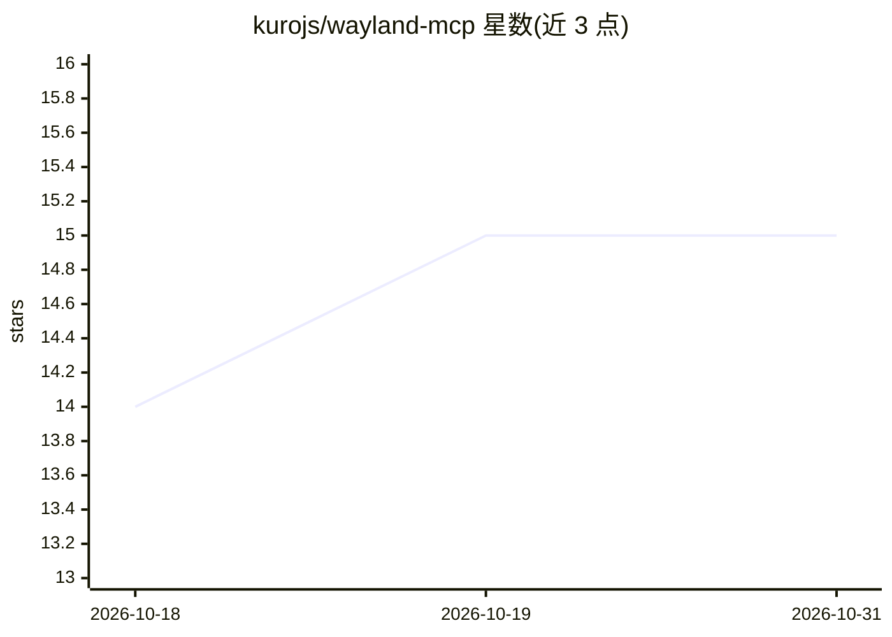

# kurojs/wayland-mcp

⭐ 15 · Python · GPL-3.0 · 推送 2026-10-19 · [GitHub](https://github.com/kurojs/wayland-mcp) · [官网](https://pypi.org/project/wayland-mcp-kurojs/) · 个人维护

**Wayland 桌面自动化 MCP 服务器：截屏 VLM 分析与键鼠控制**

面向 Wayland 会话的 Model Context Protocol 服务器，供 MCP 客户端（如 Claude Desktop）调用：截屏后交由视觉语言模型（OpenRouter/Gemini/Azure）分析，控制指针与键盘，并以 chain 语法串联多步操作。安装无需 root，输入经 XDG RemoteDesktop 门户合成；服务器探测会话能力后自动选择最高优先级的截屏/输入后端，describe_environment 工具报告选择依据。仅 COSMIC 行经真机验证，其余桌面兼容性由后端需求推导。区域截屏、非 US 键盘布局等存在已知限制。

## 筛选速览

| 维度 | 判定 | 备注 |
|---|---|---|
| AI 角色 | `ai-ecosystem` | LLM/agent 周边工具 |
| 许可风险 | `viral` | GPL-3.0 |
| 部署形态 | `library` | 以包/库形式分发 |
| 模型依赖 | locked-api |  |
| 硬件要求 | — | 无带数字的原话,不猜 |
| 安装摩擦 | `low` | 无编译、无系统依赖或容器化 |
| 成熟度 | — | 结构信号不足 |

## 能力要点

- 无特权安装：输入经 XDG RemoteDesktop 门户，无需 root 或 /dev/input 写权限
- 按会话实际能力探测并自动选择截屏/输入后端（describe_environment 报告依据）
- VLM 图像分析支持 OpenRouter / Gemini / Azure，多模型可选（Claude、GPT-4V、Qwen 等）
- chain 语法串联多步操作（点击/输入/按键）

## 适用场景

- 让 Claude Desktop 等 MCP 客户端读取屏幕内容并回答
- 通过 AI 助手在 Wayland 桌面上执行点击、拖拽、输入等自动化操作
- 多步桌面工作流的链式自动化

## 场景标签

`GUI 自动化` · 领域:效率与自动化

## 证据(README 行号)

> L15: Wayland MCP Server lets AI assistants interact with a Wayland desktop through the
> L16: Model Context Protocol. It captures the screen for visual analysis by a vision
> L17: language model, controls the pointer and keyboard, and chains actions into

## 星数曲线

2026-10-18 14 → 2026-10-31 15（+1）

---
*卡片 v1 · prompt 1.4 · 生成 2026-10-30 · 置信度 high · 依据 README sha `baccbdfe80f2` · [字段定义](../../DATASET.md)*
