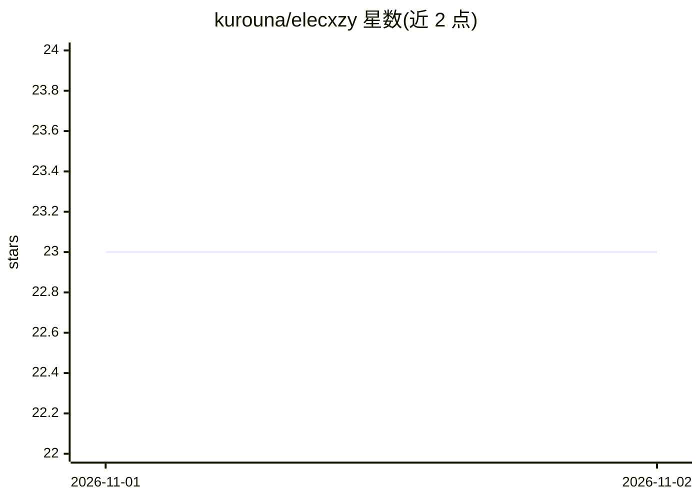

# kurouna/elecxzy

⭐ 23 · MIT · 推送 2026-10-31 · [GitHub](https://github.com/kurouna/elecxzy) · 个人维护 · 中文 README

**带 MCP 服务器的 Emacs 键位文本编辑器（Windows）**

基于 Electron + React + TypeScript 的 Windows 文本编辑器，提供 Emacs 键位与窗口布局操作，但不含 Lisp 引擎，配置采用静态 JSON 文件。内置 MCP 服务器，使 Claude Desktop 等 AI 助手能直接控制编辑器。技术实现包括 RB-Tree Piece Table 缓冲管理、Canvas 虚拟渲染（全/半角混排）、IME 组合事件处理；功能覆盖增量搜索、Markdown/HTML 实时预览、文件标签页、侧栏文件管理器、大纲视图、Kill Ring/寄存器/撤销历史侧栏及 Git 集成视图。经 Microsoft Store 或 GitHub Releases 二进制分发，源码仓库未公开。

## 筛选速览

| 维度 | 判定 | 备注 |
|---|---|---|
| AI 角色 | `ai-enhanced` | 去掉 AI 部分产品仍成立 |
| 许可风险 | `permissive` | MIT |
| 部署形态 | `desktop` | 安装包/桌面程序 |
| 模型依赖 | locked-api |  |
| 硬件要求 | — | 无带数字的原话,不猜 |
| 安装摩擦 | `low` | 无编译、无系统依赖或容器化 |
| 成熟度 | — | 结构信号不足 |

## 能力要点

- 内置 MCP 服务器，供 Claude Desktop 等 AI 助手直接驱动编辑器
- RB-Tree Piece Table 缓冲管理与 Canvas 虚拟渲染，支持全/半角混排文本度量
- Emacs 键位体系：窗口分割/布局重塑/winner-mode 式布局历史/kill ring
- 静态 JSON 配置（config.json / keybinds.json），开箱即用默认设置

## 适用场景

- 在 Windows 上获得 Emacs 键位编辑体验而无需配置 Lisp
- 让 Claude 等 AI 助手通过 MCP 直接执行编辑操作
- 在同一编辑器内完成 Markdown 预览、大纲导航与 Git 提交管理

## 场景标签

 · 领域:开发工具/编辑器

## 证据(README 行号)

> L7: **A Lisp-free text editor with Emacs keybindings, featuring a built-in MCP server for AI-driven editing.**
> L15: `elecxzy` is a text editor developed to provide an Emacs-like editing experience within a web technology stack (Ele
> L21: Microsoft Store

## 星数曲线

2026-11-01 23 → 2026-11-02 23（+0）

---
*卡片 v1 · prompt 1.4 · 生成 2026-10-31 · 置信度 high · 依据 README sha `836f90bc1d0e` · [字段定义](../../DATASET.md)*
