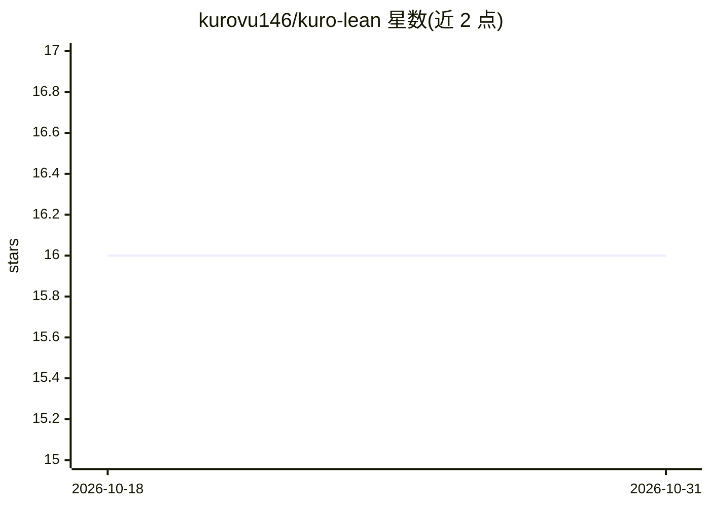

# kurovu146/kuro-lean

⭐ 16 · TypeScript · MIT · 推送 2026-08-17 · [GitHub](https://github.com/kurovu146/kuro-lean) · 个人维护

**给 AI 编码 agent 的 CLI：压缩输出、拦截高耗 token 调用并计价**

基于 Bun 的独立 CLI（kt），服务于 AI 编码 agent 的 token 成本控制：按命令类型（test/build/lint/git 等）压缩 shell 输出并保存完整日志；通过 PreToolUse 钩子拦截全盘扫描、整文件读取等高耗调用；从 Claude Code transcript 读取 usage 计算真实账单；从磁盘 transcript 重建缓存过期的会话。自动集成层使用 Claude Code 的 settings schema，其他 agent 可手动使用核心 CLI。需 Bun ≥1.3，无构建步骤。

## 筛选速览

| 维度 | 判定 | 备注 |
|---|---|---|
| AI 角色 | `ai-ecosystem` | LLM/agent 周边工具 |
| 许可风险 | `permissive` | MIT |
| 部署形态 | `library` | 以包/库形式分发 |
| 模型依赖 | — | README 未给出锁定关系 |
| 硬件要求 | — | 无带数字的原话,不猜 |
| 安装摩擦 | `low` | 无编译、无系统依赖或容器化 |
| 成熟度 | — | 结构信号不足 |

## 能力要点

- 按命令 profile 压缩 shell 输出，测试/构建失败内容不压缩
- PreToolUse 钩子拦截 find /、读取大文件与 lock 文件等高耗调用
- kt cost 从 transcript usage 计算真实账单（缓存读 45%/写 44%）
- kt handoff --recover 从磁盘 transcript 重建缓存过期会话

## 适用场景

- 降低 AI 编码 agent 会话的 token 开销
- 拦截会向上下文倾倒噪音的命令调用
- 查看基于真实 transcript 的分项成本
- 恢复 prompt 缓存已过期的死会话

## 场景标签

`LLM 可观测性` · 领域:评测与运维

## 证据(README 行号)

> L41: 1. **Core CLI** (`kt run`, `kt show`, `kt stats`, `kt cost`, `kt handoff`) — a standalone Bun CLI.
> L43: 2. **Auto-integration** (`kt init`) — registers hooks that rewrite commands, block noise and render

## 星数曲线

2026-10-18 16 → 2026-10-31 16（+0）

---
*卡片 v1 · prompt 1.4 · 生成 2026-10-30 · 置信度 high · 依据 README sha `077aa03a7ae8` · [字段定义](../../DATASET.md)*
