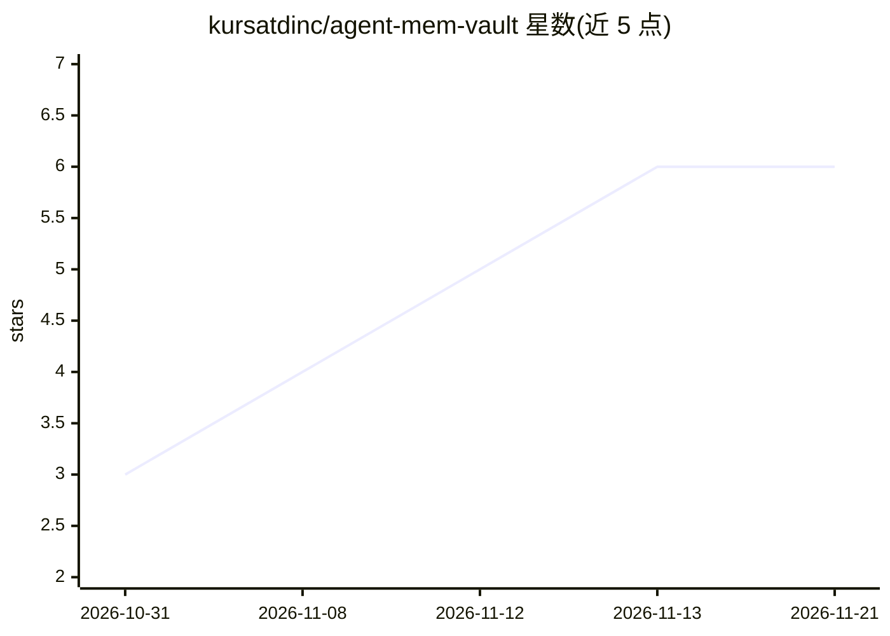

# kursatdinc/agent-mem-vault

⭐ 6 · Python · MIT · 推送 2026-11-18 · [GitHub](https://github.com/kursatdinc/agent-mem-vault) · [官网](https://pypi.org/project/agent-mem-vault/) · 个人维护

**为编码 agent 提供共享长期记忆的 MCP 服务器，存为 Obsidian vault**

agent-mem-vault 是一个 MCP 服务器，把 Obsidian vault 作为编码 agent 的长期记忆存储。Claude Code、Codex 及其他 MCP 客户端将决策、风险、快照等类型化记录写入 vault，每项目维护会话卡片与开放线程，供下次会话或其他工具读取。记忆为 Markdown 笔记，用户可在 Obsidian 中查看图谱并直接修正；带文件锁串行写入、修订检查、秘密脱敏机制。需 uv 与 Python 3.12+，依赖 fcntl，不支持 Windows。

## 筛选速览

| 维度 | 判定 | 备注 |
|---|---|---|
| AI 角色 | `ai-ecosystem` | LLM/agent 周边工具 |
| 许可风险 | `permissive` | MIT |
| 部署形态 | `library` | 以包/库形式分发 |
| 模型依赖 | — | README 未给出锁定关系 |
| 硬件要求 | — | 无带数字的原话,不猜 |
| 安装摩擦 | `low` | 无编译、无系统依赖或容器化 |
| 成熟度 | — | 结构信号不足 |

## 能力要点

- 跨工具共享记忆：Claude Code 与 Codex 读写同一份记录
- 类型化记录（decision/risk/snapshot/note/assumption/task）支持精确查询
- 记忆为 Markdown 笔记，可在 Obsidian 中阅读、链接、手动修正
- 文件锁与修订检查防止丢失写入与静默覆盖

## 适用场景

- 让多个编码 agent 跨会话共享项目决策与风险记录
- 在 Obsidian 中审计并修正 agent 的记忆内容
- 把 vault 放入 git 获得记忆的完整变更记录

## 场景标签

`Agent 记忆` `编码 Agent` `知识库管理` · 领域:Agent 开发

## 证据(README 行号)

> L11: agent-mem-vault is an MCP server that turns an
> L92: - Claude Code and Codex read and write the same records.
> L226: Requires Python 3.12+ on macOS or Linux; file locking uses `fcntl`, so Windows is not supported

## 星数曲线

2026-10-31 3 → 2026-11-21 6（+3）

---
*卡片 v1 · prompt 1.4 · 生成 2026-11-20 · 置信度 high · 依据 README sha `b6130832b92d` · [字段定义](../../DATASET.md)*
