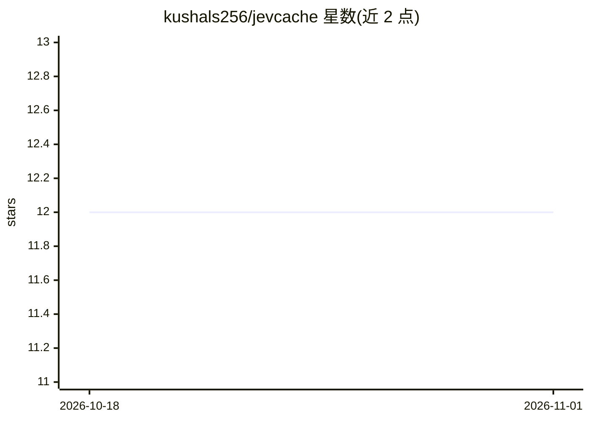

# kushals256/jevcache

⭐ 12 · TypeScript · MIT · 推送 2026-10-27 · [GitHub](https://github.com/kushals256/jevcache) · [官网](https://morrowcache.vercel.app) · 个人维护

**OpenAI 兼容的本地聊天响应缓存代理，同意图问题跳过模型调用**

面向开发者与 agent 用户的 OpenAI 兼容代理：在 /v1/chat/completions 前拦截请求，命中条件为完全相同（SHA）或经同意图裁决器（默认云端 Jev via OpenRouter，可切换本地 Kev/Laya/System One）判定的改写问句，以及 agent 同任务重试。仅缓存最终文本，含 tool_calls 的响应不存储；裁决器出错时 fail-open 照常调用上游。提供 npx 一键启动、CLI、Docker 镜像；需 Node ≥ 22.5，使用内置 node:sqlite 无需原生编译。限制：SQLite 单进程不可多副本共库，个性化/需每次重跑工具调用的场景不适用。

## 筛选速览

| 维度 | 判定 | 备注 |
|---|---|---|
| AI 角色 | `ai-ecosystem` | LLM/agent 周边工具 |
| 许可风险 | `permissive` | MIT |
| 部署形态 | `self-host` | docker 或自建部署 |
| 模型依赖 | locked-api |  |
| 硬件要求 | — | 无带数字的原话,不猜 |
| 安装摩擦 | `low` | 无编译、无系统依赖或容器化 |
| 成熟度 | — | 结构信号不足 |

## 能力要点

- 同意图裁决缓存：非余弦相似度，改写问句可命中
- Agent Turn Cache：同上下文重试任务可命中，tool_calls 永不缓存
- fail-open 设计：裁决器出错仍调用上游模型
- 支持云端 Jev（OpenRouter）或本地 Kev/Laya/System One 裁决器

## 适用场景

- agent 或聊天客户端重复提问时降低延迟与调用开销
- 本地无 OpenRouter key 时用 Kev/Laya 做语义缓存
- 通过 baseURL 一行改动接入现有 OpenAI SDK 项目

## 场景标签

`模型网关` · 领域:Agent 开发

## 证据(README 行号)

> L8: **MorrowCache** — routers pick a model. This proxy decides whether to call one.
> L12: A local OpenAI-compatible **chat response cache**. **2.0 (Agent Turn Cache)** skips the model in two cases: the sam
> L30: Works with one script, one agent, or many — anything that speaks `/v1/chat/completions`.

## 星数曲线

2026-10-18 12 → 2026-11-01 12（+0）

---
*卡片 v1 · prompt 1.4 · 生成 2026-11-01 · 置信度 high · 依据 README sha `c2e971e5a0f4` · [字段定义](../../DATASET.md)*
