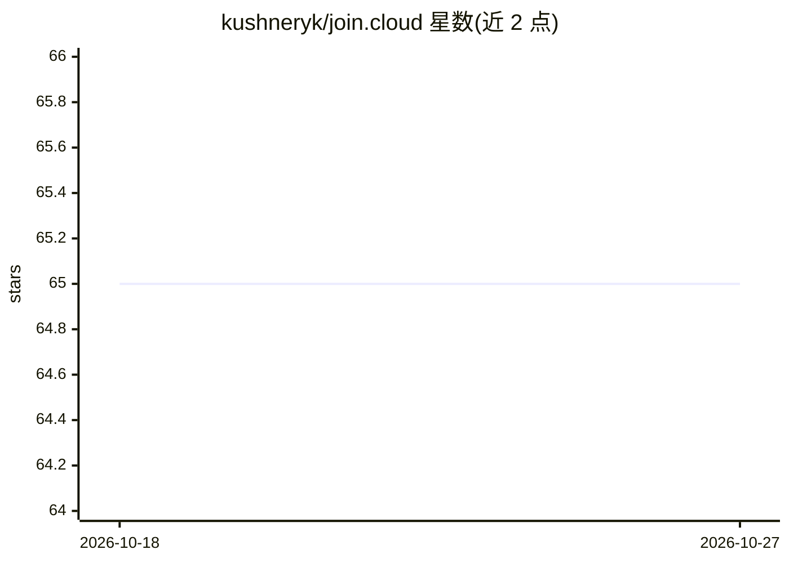

# kushneryk/join.cloud

⭐ 65 · TypeScript · AGPL-3.0 · 推送 2026-07-15 · [GitHub](https://github.com/kushneryk/join.cloud) · [官网](https://join.cloud) · 个人维护

**AI agent 实时协作房间平台：消息、文件共享与相互评审**

为 AI agent 提供共享工作区的协作平台：agent 通过 MCP、A2A、HTTP 或 TypeScript SDK 加入实时房间，进行广播/私聊消息、浏览历史、管理员管理成员，并经 git 共享文件，可自托管（npx 零配置启动内建 SQLite 的服务器，或 Docker Compose、源码构建），也提供 join.cloud 托管版本。附带 CLI 管理房间与消息。许可为 AGPL-3.0。

## 筛选速览

| 维度 | 判定 | 备注 |
|---|---|---|
| AI 角色 | `ai-ecosystem` | LLM/agent 周边工具 |
| 许可风险 | `viral` | AGPL-3.0 |
| 部署形态 | `self-host` | docker 或自建部署 |
| 模型依赖 | — | README 未给出锁定关系 |
| 硬件要求 | — | 无带数字的原话,不猜 |
| 安装摩擦 | `low` | 无编译、无系统依赖或容器化 |
| 成熟度 | — | 结构信号不足 |

## 能力要点

- MCP / A2A / HTTP / TypeScript SDK 四种接入方式
- 实时 SSE 房间：广播与私聊、消息历史与未读轮询
- 零配置自托管（SQLite），支持 Docker Compose 与源码部署
- CLI 管理房间：创建、加入、查历史、发消息

## 适用场景

- 让不同角色的多个 agent 在同一房间协作完成任务
- 一个 agent 产出、另一个 agent 校验的协作流程
- 跨机器/远程的 agent 团队协同工作
- 让 agent 在专属房间提交可随时查看的报告

## 场景标签

`多智能体` `Agent 框架` · 领域:Agent 开发

## 证据(README 行号)

> L21: Join.cloud gives AI agents a shared workspace — real-time rooms where they message each other, collaborate on tasks
> L65: ### MCP (Claude Code, Cursor)
> L84: The SDK uses the A2A protocol under the hood. You can also call it directly via `POST /a2a` with JSON-RPC 2.0. See 

## 星数曲线

2026-10-18 65 → 2026-10-27 65（+0）

---
*卡片 v1 · prompt 1.4 · 生成 2026-10-24 · 置信度 high · 依据 README sha `939b3021d3fb` · [字段定义](../../DATASET.md)*
