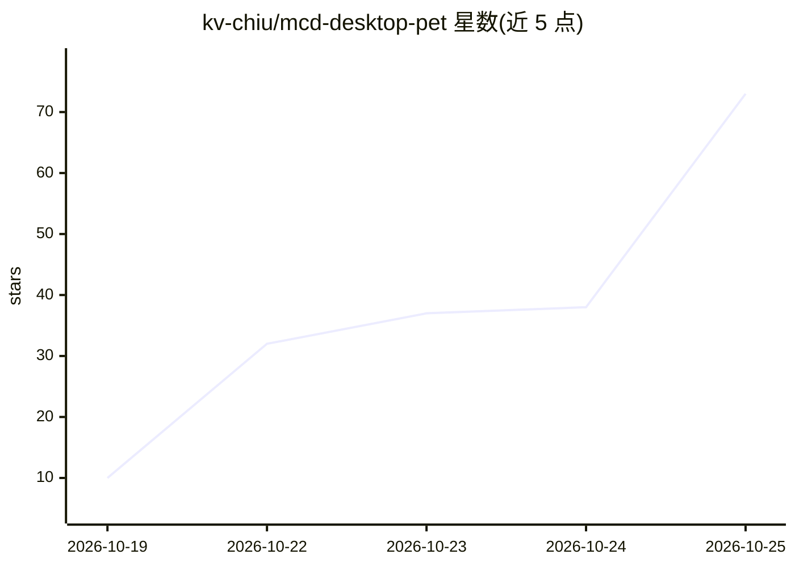

# kv-chiu/mcd-desktop-pet

⭐ 73 · Go · MIT · 推送 2026-10-24 · [GitHub](https://github.com/kv-chiu/mcd-desktop-pet) · [官网](https://www.bilibili.com/video/BV1DuJR6WE17) · 个人维护 · 中文 README

**麦当劳 MCP 桌面宠物「薯条小宝」：领券、营养查询与午休提醒**

用 Godot 呈现动画的桌面宠物，点击可互动、拖拽、执行散步/跳跃等动作，并内置可自定义时段的午休闹钟。配套 React Web 控制台，通过本地中枢连接麦当劳 MCP 服务，提供领券、活动日历、餐品营养查询、积分商城、门店点餐等入口，内置 33 项工具定义；另提供 AI Agent Skill 与 CLI，将自然语言需求转为 MCP 工具调用并以桌宠气泡反馈。为麦当劳程序员创意开发大赛参赛作品，非官方产品；六步演示流程由模拟脚本驱动。Windows/macOS 提供单可执行分发物，零环境依赖。

## 筛选速览

| 维度 | 判定 | 备注 |
|---|---|---|
| AI 角色 | `ai-enhanced` | 去掉 AI 部分产品仍成立 |
| 许可风险 | `permissive` | MIT |
| 部署形态 | `desktop` | 安装包/桌面程序 |
| 模型依赖 | — | README 未给出锁定关系 |
| 硬件要求 | — | 无带数字的原话,不猜 |
| 安装摩擦 | `low` | 无编译、无系统依赖或容器化 |
| 成熟度 | `idea` | |

## 能力要点

- 桌宠动画（Godot）+ 漫步/摸头/拖拽等互动与可定制午休提醒
- Web 控制台通过本地中枢调用麦当劳 MCP（领券、营养、积分、门店等 33 项工具）
- 提供 AI Agent Skill 与 CLI，自然语言转 MCP 工具调用，结果由桌宠气泡展示
- Windows/macOS 一体化单可执行分发，零环境依赖

## 适用场景

- 工作学习时桌面陪伴并按时提醒午休用餐
- 图形界面领取麦当劳优惠券、查营养信息和积分
- 开发者通过 Skill/CLI 用自然语言调用麦当劳 MCP 工具

## 场景标签

 · 领域:生活服务/桌面工具

## 证据(README 行号)

> L9: 它不仅能在你的桌面上闲庭漫步、接受摸头互动，还是一位麦麦生活管家——定时提醒午餐、一键领取优惠券、查询餐品营养信息，并通过网页控制台调用麦当劳 MCP 服务。项目目前内置 33 项工具定义，实际可用能力以官方服务返回及账号权限为准。
> L19: - **使用 AI Agent 的开发者**：通过项目提供的 Skill 和 CLI，将自然语言需求转为 MCP 工具调用，并让桌宠展示业务反馈。

## 星数曲线

2026-10-19 10 → 2026-10-25 73（+63）

---
*卡片 v1 · prompt 1.4 · 生成 2026-10-24 · 置信度 high · 依据 README sha `863be6cbf8c2` · [字段定义](../../DATASET.md)*
