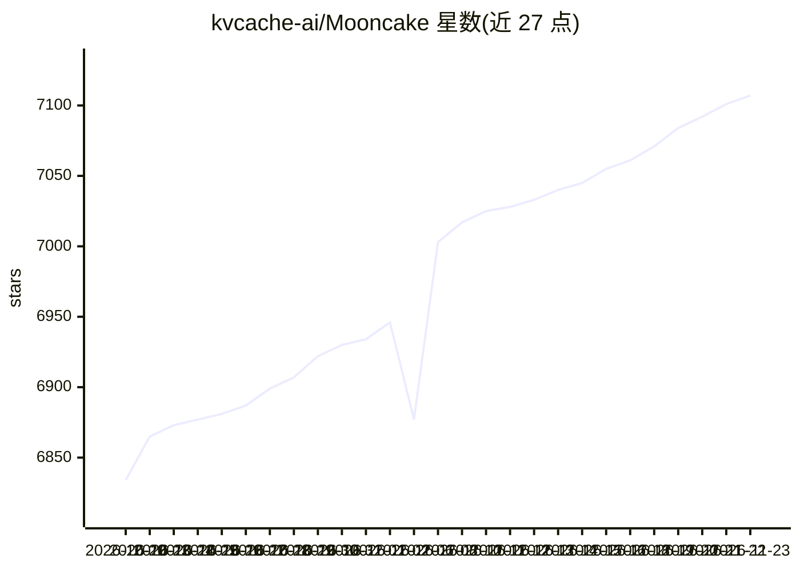

# kvcache-ai/Mooncake

⭐ 7,107 · C++ · Apache-2.0 · 推送 2026-11-22 · [GitHub](https://github.com/kvcache-ai/Mooncake) · [官网](https://kvcache-ai.github.io/Mooncake/) · 组织维护 · 中文 README

**Kimi 背后的 LLM 推理服务平台：KVCache 为中心的 PD 分离架构**

面向大规模 LLM 推理与训练的基础设施项目，核心是以 KVCache 为中心的分离架构：将 prefill 与 decode 集群分离，并利用 GPU 集群中闲置的 CPU、DRAM、SSD 资源构建分离式 KVCache 池。组件包括跨异构网络与加速器进行低延迟数据搬运的 Transfer Engine、分布式 KVCache 与模型权重管理的 Mooncake Store、面向弹性 MoE 服务的 Mooncake EP & PG，与 SGLang、vLLM 等推理框架深度集成，支持 PyPI 安装并提供 CUDA/NPU/ROCm 等多硬件变体。

## 筛选速览

| 维度 | 判定 | 备注 |
|---|---|---|
| AI 角色 | `ai-ecosystem` | LLM/agent 周边工具 |
| 许可风险 | `permissive` | Apache-2.0 |
| 部署形态 | `library` | 以包/库形式分发 |
| 模型依赖 | local-ok | 支持本地模型 |
| 硬件要求 | — | 无带数字的原话,不猜 |
| 安装摩擦 | `medium` | 含编译或系统依赖之一 |
| 成熟度 | — | 结构信号不足 |

## 能力要点

- Transfer Engine 支持多 RDMA NIC 带宽聚合、拓扑感知路径选择与自动故障切换
- 在 4×200Gbps/8×400Gbps RoCE 网络下分别达 87/190 GB/s 传输带宽
- Mooncake Store 提供分布式 KVCache 池与跨实例前缀复用
- PyPI 提供 CUDA 12.9/13.0-13.1/Non-CUDA/NPU/MUSA/ROCm 多种安装变体

## 适用场景

- 为大模型推理服务部署 PD 分离架构以提升集群资源利用率
- 为 vLLM/SGLang 推理实例配置跨节点共享 KVCache 池
- 在分布式强化学习训练中做 rollout 与训练间数据搬运
- 多节点集群上的弹性 MoE 推理部署

## 场景标签

`推理引擎` · 领域:训练与推理

## 证据(README 行号)

> L22: Mooncake is the serving platform for icon Kimi, a leading LLM service provided by icon Moonshot AI.
> L83: Mooncake is an infrastructure project for large-scale LLM inference and training. It features a KV cache-centric di
> L85: Mooncake includes a high-performance Transfer Engine for low-latency data movement across heterogeneous networks an

## 星数曲线

2026-10-20 6,834 → 2026-11-23 7,107（+273）

---
*卡片 v1 · prompt 1.4 · 生成 2026-11-23 · 置信度 high · 依据 README sha `f4a1b90315ed` · [字段定义](../../DATASET.md)*
