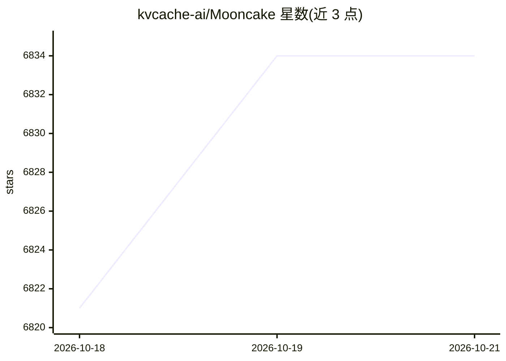

# kvcache-ai/Mooncake

⭐ 6,834 · C++ · Apache-2.0 · 推送 2026-10-19 · [GitHub](https://github.com/kvcache-ai/Mooncake) · [官网](https://kvcache-ai.github.io/Mooncake/) · 组织维护 · 中文 README

**面向大规模 LLM 推理/训练的 KVCache 中心化解耦架构基础设施**

Moonshot AI（月之暗面）开源的大规模 LLM 推理与训练基础设施，即 Kimi 服务的底层平台。核心组件包括：高性能 Transfer Engine（跨 RDMA/TCP/EFA/NVLink 等异构网络与加速器的批量数据传输）、Mooncake Store（分布式 KV cache 与模型权重管理池，利用集群中闲置的 CPU/DRAM/SSD 资源）、以及 Mooncake EP & PG（弹性 MoE 服务）。架构上将 prefill 与 decode 集群分离，并已与 vLLM、SGLang、TensorRT-LLM、LMDeploy 等推理引擎集成。通过 PyPI 提供多种变体轮子（CUDA、Non-CUDA、NPU、MUSA、ROCm 等），并提供 Docker 镜像。

## 筛选速览

| 维度 | 判定 | 备注 |
|---|---|---|
| AI 角色 | `ai-ecosystem` | LLM/agent 周边工具 |
| 许可风险 | `permissive` | Apache-2.0 |
| 部署形态 | `library` | 以包/库形式分发 |
| 模型依赖 | local-ok | 支持本地模型 |
| 硬件要求 | — | 无带数字的原话,不猜 |
| 安装摩擦 | `medium` | 含编译或系统依赖之一 |
| 成熟度 | — | 结构信号不足 |

## 能力要点

- Transfer Engine 支持 RDMA/TCP/EFA/NVMe-oF/NVLink 等多种传输协议，拓扑感知路由与多网卡带宽聚合
- Mooncake Store 分布式 KV cache 池，复用 GPU 集群闲置 CPU/DRAM/SSD
- Prefill/Decode 分离解耦架构，支持弹性 MoE 服务（EP & PG）
- 被 vLLM、SGLang、TensorRT-LLM、vLLM-Ascend、NIXL 等生产推理栈采用

## 适用场景

- 大规模 LLM 服务的 PD 分离部署与 KV cache 跨实例复用
- 多节点训练/rollout 之间的权重与数据高效传输
- 在异构加速器（CUDA/NPU/MUSA/ROCm）环境下构建分布式 KV cache 池

## 场景标签

`推理引擎` · 领域:训练与推理

## 证据(README 行号)

> L83: Mooncake is an infrastructure project for large-scale LLM inference and training. It features a KV cache-centric di
> L85: Mooncake includes a high-performance Transfer Engine for low-latency data movement across heterogeneous networks an

## 星数曲线

2026-10-18 6,821 → 2026-10-21 6,834（+13）

---
*卡片 v1 · prompt 1.4 · 生成 2026-10-20 · 置信度 high · 依据 README sha `fb25ca7b262c` · [字段定义](../../DATASET.md)*
