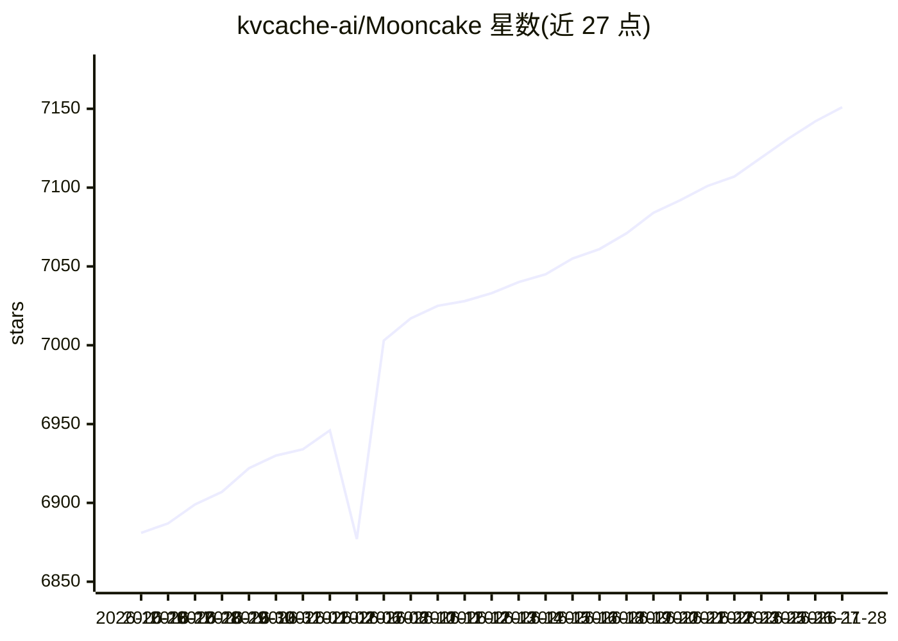

# kvcache-ai/Mooncake

⭐ 7,151 · C++ · Apache-2.0 · 推送 2026-11-27 · [GitHub](https://github.com/kvcache-ai/Mooncake) · [官网](https://kvcache-ai.github.io/Mooncake/) · 组织维护 · 中文 README

**LLM 推理/训练的 KVCache 分离式服务基础设施**

Mooncake 是面向大规模 LLM 推理与训练的基础设施项目，也是 Moonshot AI 的 Kimi 服务所运行的平台。其核心是以 KVCache 为中心的分离式架构：将 prefill 与 decode 集群分离，并利用 GPU 集群中闲置的 CPU、DRAM 与 SSD 资源构建分布式 KV cache 池。组件包括 Transfer Engine（跨异构网络/加速器的低延迟数据传输）、Mooncake Store（分布式 KV cache 与模型权重管理）和 Mooncake EP & PG（弹性 MoE 服务），与 SGLang、vLLM 等推理框架深度集成。提供 PyPI 多硬件变体安装与文档。

## 筛选速览

| 维度 | 判定 | 备注 |
|---|---|---|
| AI 角色 | `ai-ecosystem` | LLM/agent 周边工具 |
| 许可风险 | `permissive` | Apache-2.0 |
| 部署形态 | `library` | 以包/库形式分发 |
| 模型依赖 | local-ok | 支持本地模型 |
| 硬件要求 | — | 无带数字的原话,不猜 |
| 安装摩擦 | `high` | 编译与系统依赖俱全 |
| 成熟度 | — | 结构信号不足 |

## 能力要点

- Transfer Engine 支持 RDMA 多 NIC 带宽聚合、拓扑感知路径选择与故障自动换路
- Mooncake Store 提供分布式 KV cache 与模型权重管理
- 已集成至 vLLM、SGLang、TensorRT-LLM、LMDeploy 等推理栈
- 提供 CUDA/NPU/MUSA/ROCm 等 PyPI 安装变体

## 适用场景

- 为多节点 LLM 推理集群搭建分离式 prefill/decode 服务
- 跨推理实例共享与复用 KV cache
- 分布式 RL 训练中在 rollout 与训练节点间传输权重和状态

## 场景标签

`推理引擎` `强化学习` · 领域:训练与推理

## 证据(README 行号)

> L83: Mooncake is an infrastructure project for large-scale LLM inference and training. It features a KV cache-centric di
> L85: Mooncake includes a high-performance Transfer Engine for low-latency data movement across heterogeneous networks an
> L91: The core of Mooncake is the Transfer Engine (TE), a high-performance data transfer framework. TE offers a unified i

## 星数曲线

2026-10-26 6,881 → 2026-11-28 7,151（+270）

---
*卡片 v1 · prompt 1.4 · 生成 2026-11-27 · 置信度 high · 依据 README sha `ea8d92138f8e` · [字段定义](../../DATASET.md)*
