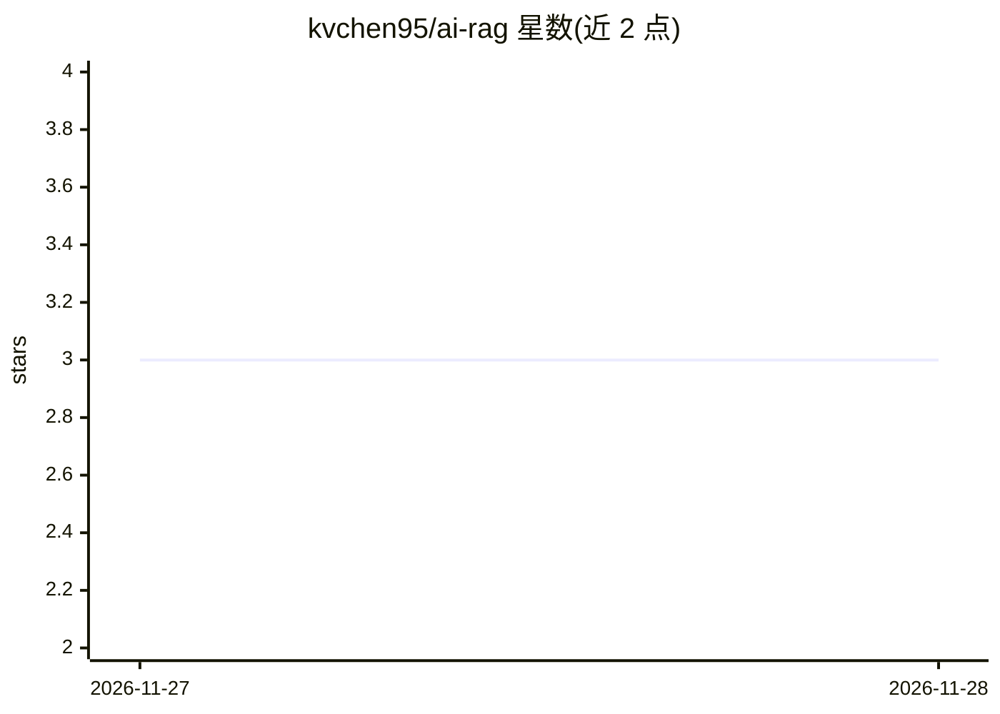

# kvchen95/ai-rag

⭐ 3 · Python · 推送 2026-11-27 · [GitHub](https://github.com/kvchen95/ai-rag) · 个人维护 · 中文 README

**企业私有化 PDF 知识库问答助手，带引用与拒答门控**

以 Docker Compose 编排 7 个服务（PostgreSQL/Qdrant/embedding/rerank/api/worker/web）的私有化 PDF 问答系统，文档扫描入库按版本管理，含转正、漂移校对等摄取流程。问答侧设拒答门控，每条结论附可点回原文的角标；通过 make eval 跑黄金 50 题评测，四条设计红线约束拒答率、数值准确率、角标可点回率与忠实度。配套分层架构、概要与详细设计文档，环境变量配置 LLM 网关地址、key 与模型。

## 筛选速览

| 维度 | 判定 | 备注 |
|---|---|---|
| AI 角色 | `ai-native` | 本体是模型或模型工具 |
| 许可风险 | `none` | — |
| 部署形态 | `self-host` | docker 或自建部署 |
| 模型依赖 | — | README 未给出锁定关系 |
| 硬件要求 | — | 无带数字的原话,不猜 |
| 安装摩擦 | `low` | 无编译、无系统依赖或容器化 |
| 成熟度 | — | 结构信号不足 |

## 能力要点

- 带引用问答：结论角标可点回原文（红线可点回率 ≥98%）
- 拒答门控：陷阱题拒答率 100% 的评测红线
- docker compose 一键启动 7 服务，PG 为存储基准修向量库漂移
- make eval 黄金 50 题评测，退出码区分达标/不达标/不可测

## 适用场景

- 把企业 PDF 文档私有化入库做带引用问答
- 对知识库系统做拒答率与数值准确率验收评测
- 运维多版本文档摄取并校对向量库漂移

## 场景标签

`文档问答` `RAG` · 领域:知识与检索

## 证据(README 行号)

> L3: 私有化 PDF 知识库问答：答得上就答，答不上就说不知道，每条结论可点回原文。
> L21: docker compose up -d          # 7 个服务：PG / Qdrant / embedding / rerank / api / worker / web

## 星数曲线

2026-11-27 3 → 2026-11-28 3（+0）

---
*卡片 v1 · prompt 1.4 · 生成 2026-11-27 · 置信度 mid · 依据 README sha `160b4489a61e` · [字段定义](../../DATASET.md)*
