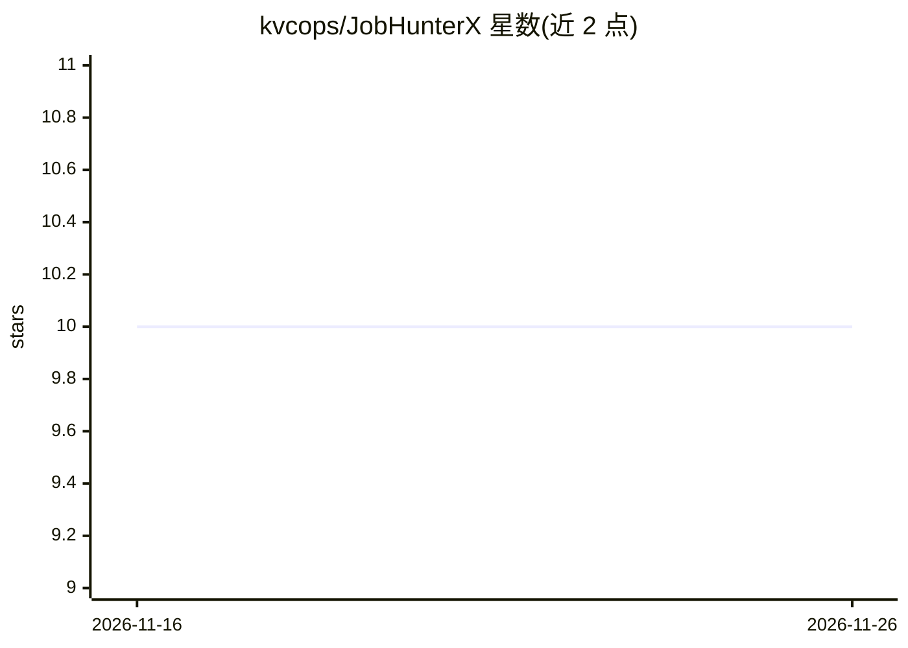

# kvcops/JobHunterX

⭐ 10 · Python · 推送 2026-11-16 · [GitHub](https://github.com/kvcops/JobHunterX) · [官网](https://kvcops.github.io/JobHunterX/) · 组织维护

**面向印度求职者的 AI 找工作助手：匹配、解释、写简历并自动投递**

一个本地运行的求职助手应用：读取用户简历 PDF 构建画像，抓取雇主官网招聘页与社区招聘帖，对每个职位给出匹配分和'被看到几率'评分，并解释评分依据；据职位生成一页简历、求职信与 CV，AI 编辑逐条对照用户简历做事实核查。浏览器 agent 在应用内自动填写申请表单，遇 CAPTCHA 或登录时用户可接管。内置印度海得拉巴/班加罗尔 130 家公司观察名单、4 小时轮询、诈骗职位过滤与申请结果追踪。提供 Windows/macOS/Linux 安装包。

## 筛选速览

| 维度 | 判定 | 备注 |
|---|---|---|
| AI 角色 | `ai-native` | 本体是模型或模型工具 |
| 许可风险 | `none` | — |
| 部署形态 | `desktop` | 安装包/桌面程序 |
| 模型依赖 | — | README 未给出锁定关系 |
| 硬件要求 | — | 无带数字的原话,不猜 |
| 安装摩擦 | `low` | 无编译、无系统依赖或容器化 |
| 成熟度 | — | 结构信号不足 |

## 能力要点

- 浏览器 agent 在应用内实时填写申请表单，支持人工接管
- 每个职位同时给出匹配分与'被看到几率'评分及解释
- AI 生成/编辑简历、求职信、CV，并对照用户简历做事实核查
- 130 家公司观察名单每 4 小时轮询官网招聘页，含诈骗过滤

## 适用场景

- 我想优先申请刚发布、竞争少的职位而不是海投
- 让 AI 读懂我的简历并解释每个职位为什么匹配或不匹配
- 自动填写申请表，遇到验证码时我自己接管完成

## 场景标签

`浏览器自动化` `AI 写作` · 领域:效率与自动化

## 证据(README 行号)

> L5:  🚀 AI career intelligence: understands your career, finds roles that genuinely fit, explains every match, and prepar
> L9: **JobHunterX** reads your resume, finds real jobs that truly fit you, tells you *why* each one fits (or doesn't),
> L10: writes an honest one-page resume, a cover letter and a CV for you — and then a browser agent fills the application

## 星数曲线

2026-11-16 10 → 2026-11-26 10（+0）

---
*卡片 v1 · prompt 1.4 · 生成 2026-11-19 · 置信度 mid · 依据 README sha `ca23cdf1b7b9` · [字段定义](../../DATASET.md)*
