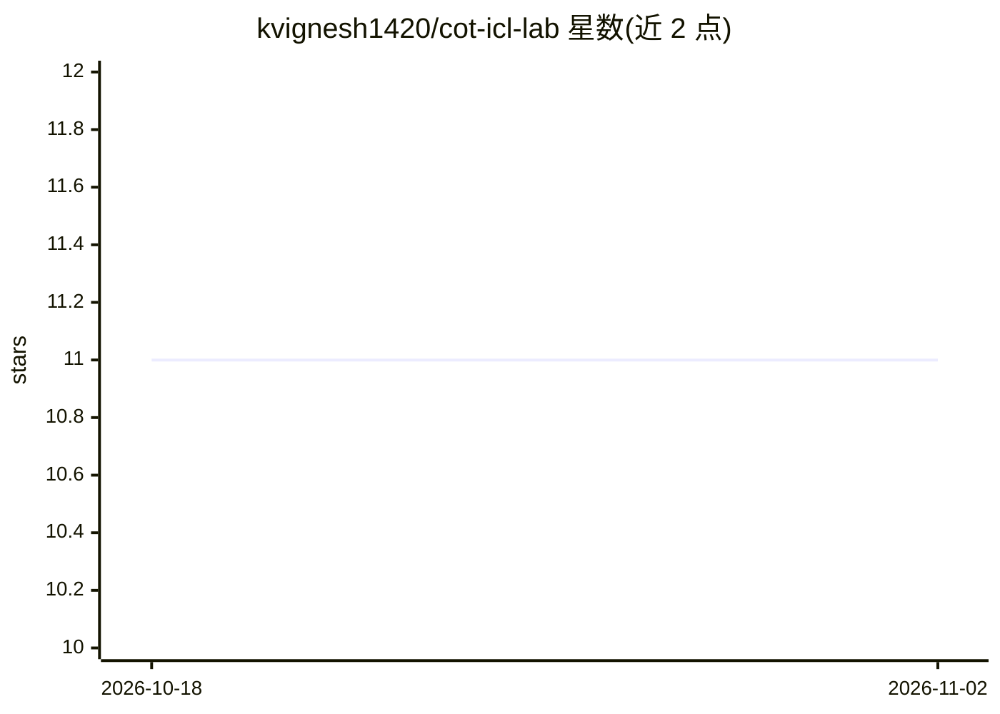

# kvignesh1420/cot-icl-lab

⭐ 11 · Python · MIT · 推送 2026-07-15 · [GitHub](https://github.com/kvignesh1420/cot-icl-lab) · [官网](https://kvignesh1420.github.io/cot-icl-lab/) · 个人维护

**研究生成合成数据以元训练与评测 transformer 的 CoT/ICL 框架**

用于研究链式思维（CoT）与上下文学习（ICL）的训练测试框架：通过 DAG 与 TokenProcessor 类生成合成 token 化数据集，可配置输入/链式 token 结构与任务难度（TokenCoverage 指标）。基于 HuggingFace transformers 构建自定义 Llama 模型并提供 MODEL_REGISTRY 注册新架构；支持 TASK_CARD 批量配置、torch DDP 分布式训练、stdout/MLFlow 指标记录，以及可选的 vLLM/SGLang 推理评测。环境用 pixi 管理，默认 CPU 环境，另有 CUDA 训练环境。有两篇 ACL 论文关联。

## 筛选速览

| 维度 | 判定 | 备注 |
|---|---|---|
| AI 角色 | `ai-ecosystem` | LLM/agent 周边工具 |
| 许可风险 | `permissive` | MIT |
| 部署形态 | `library` | 以包/库形式分发 |
| 模型依赖 | local-ok | 支持本地模型 |
| 硬件要求 | — | 无带数字的原话,不猜 |
| 安装摩擦 | `medium` | 含编译或系统依赖之一 |
| 成熟度 | — | 结构信号不足 |

## 能力要点

- DAG + TokenProcessor 生成可控结构的合成 token 化训练数据集
- 基于 HuggingFace transformers 的 MODEL_REGISTRY 可注册自定义模型架构
- TASK_CARD + torch DDP 批量启动分布式训练，支持 MLFlow 日志
- 可选 vLLM/SGLang 后端评测训练后的模型与 checkpoint

## 适用场景

- 研究生元训练中 CoT 示例数量对模型行为的影响
- 构建可控难度的合成 ICL 数据集训练小型 transformer
- 在不同推理后端下评测训练出的模型预测准确率

## 场景标签

`模型评测` `模型训练` · 领域:评测与运维

## 证据(README 行号)

> L2:  A Synthetic Framework for Studying Chain-of-Thought Learning from In-Context Demonstrations
> L52: Our framework serves as a test bed to generate synthetic tokenized datasets for training and evaluating transformer

## 星数曲线

2026-10-18 11 → 2026-11-02 11（+0）

---
*卡片 v1 · prompt 1.4 · 生成 2026-11-02 · 置信度 mid · 依据 README sha `9fcbdbe36788` · [字段定义](../../DATASET.md)*
