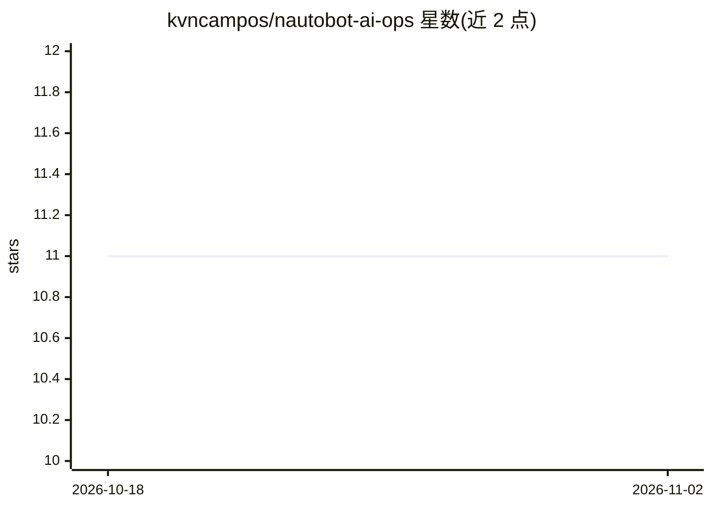

# kvncampos/nautobot-ai-ops

⭐ 11 · Python · Apache-2.0 · 推送 2026-03-09 · [GitHub](https://github.com/kvncampos/nautobot-ai-ops) · [官网](https://kvncampos.github.io/nautobot-ai-ops/) · 个人维护

**给 Nautobot 网络运维的 AI 插件：多 LLM 聊天助手与 MCP 集成**

面向 Nautobot（网络自动化平台）的应用插件：基于 LangGraph/LangChain 编排多提供商 LLM（Ollama、OpenAI、Azure AI、Anthropic、HuggingFace 及自定义），提供可对话的 AI 助手，用于网络基础设施数据的问答、任务自动化与洞见输出。核心机制包括：优先级驱动的中间件链（缓存、日志、校验、重试、限流）、多 MCP 服务器接入与健康监测、基于 Redis 的会话检查点持久化、通过 Nautobot Secret 对象管理凭据。要求 Nautobot 3.0.0+、Python 3.10-3.12、Redis 与至少一个 LLM 提供商。

## 筛选速览

| 维度 | 判定 | 备注 |
|---|---|---|
| AI 角色 | `ai-enhanced` | 去掉 AI 部分产品仍成立 |
| 许可风险 | `permissive` | Apache-2.0 |
| 部署形态 | `library` | 以包/库形式分发 |
| 模型依赖 | local-ok | 支持本地模型 |
| 硬件要求 | — | 无带数字的原话,不猜 |
| 安装摩擦 | `low` | 无编译、无系统依赖或容器化 |
| 成熟度 | `idea` | |

## 能力要点

- 多提供商 LLM 管理与自定义 provider handler
- 优先级中间件链（缓存/日志/校验/重试/限流）
- 多 MCP 服务器架构与健康监测
- Redis 检查点式会话持久化

## 适用场景

- 在 Nautobot 中用自然语言查询网络环境数据
- 接入内外部 MCP 服务器扩展网络自动化工具
- 为不同环境（LAB/NONPROD/PROD）配置多个 LLM 提供商

## 场景标签

`AI 助手` · 领域:对话与助手

## 证据(README 行号)

> L12:  An App for Nautobot.
> L16: The AI Ops app brings advanced artificial intelligence capabilities to Nautobot through a flexible multi-provider a
> L18: At its core, AI Ops leverages LangGraph and LangChain to orchestrate conversations with Large Language Models (LLMs

## 星数曲线

2026-10-18 11 → 2026-11-02 11（+0）

---
*卡片 v1 · prompt 1.4 · 生成 2026-11-02 · 置信度 mid · 依据 README sha `e1ae9cd7c37e` · [字段定义](../../DATASET.md)*
