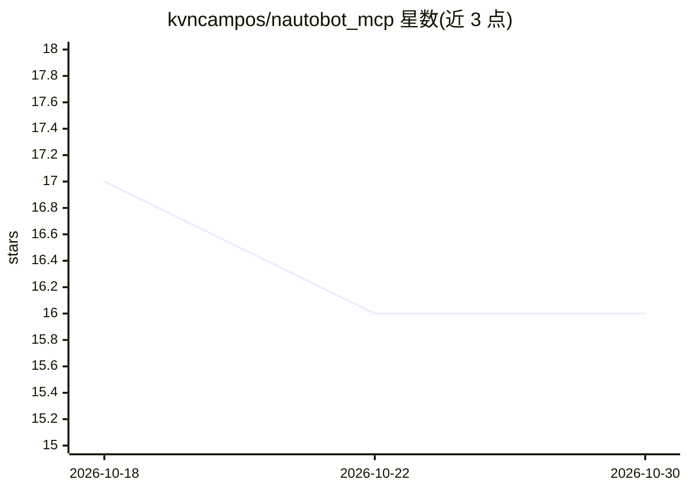

# kvncampos/nautobot_mcp

⭐ 16 · Python · MIT · 推送 2026-04-15 · [GitHub](https://github.com/kvncampos/nautobot_mcp) · [官网](https://kvncampos.github.io/nautobot_mcp/) · 个人维护

**面向 Nautobot 的 MCP 服务器：语义搜索 API 端点与知识库**

基于 Model Context Protocol 的服务器，供 MCP 客户端（如 Claude Desktop、VS Code）访问 Nautobot 实例：通过自然语言查询语义发现 API 端点、执行任意 HTTP 方法的动态 API 请求、检索官方 Nautobot 仓库构建的知识库。使用 ChromaDB 向量存储与 all-MiniLM-L6-v2 句向量模型做嵌入与缓存，Git 拉取更新仓库内容。支持 stdio 与 HTTP 两种传输模式，提供 Docker Compose 与本地 Python 安装两种方式，需 Python 3.11+ 且可访问 Nautobot 实例。

## 筛选速览

| 维度 | 判定 | 备注 |
|---|---|---|
| AI 角色 | `ai-ecosystem` | LLM/agent 周边工具 |
| 许可风险 | `permissive` | MIT |
| 部署形态 | `self-host` | docker 或自建部署 |
| 模型依赖 | — | README 未给出锁定关系 |
| 硬件要求 | — | 无带数字的原话,不猜 |
| 安装摩擦 | `low` | 无编译、无系统依赖或容器化 |
| 成熟度 | — | 结构信号不足 |

## 能力要点

- 自然语言语义搜索发现 Nautobot API 端点
- 对任意 Nautobot API 端点执行 CRUD 动态请求
- ChromaDB 向量存储的官方仓库知识库检索（RAG）
- stdio 与 HTTP 双传输模式，Docker Compose 部署

## 适用场景

- 在 Claude Desktop / VS Code 等 MCP 客户端中直接操作 Nautobot
- 用自然语言查找 Nautobot 相关 API 端点与文档
- 对多个环境（local/nonprod/prod）的 Nautobot 实例做统一访问

## 场景标签

`RAG` `语义搜索` · 领域:知识与检索

## 证据(README 行号)

> L10: A Model Context Protocol (MCP) server for interacting with Nautobot APIs using semantic search and dynamic API requ
> L25: - **Dynamic API Access**: Perform CRUD operations on any Nautobot API endpoint
> L27: - **Knowledge Base Search**: Access indexed content from official Nautobot repositories

## 星数曲线

2026-10-18 17 → 2026-10-30 16（-1）

---
*卡片 v1 · prompt 1.4 · 生成 2026-10-30 · 置信度 mid · 依据 README sha `2eda60cb141c` · [字段定义](../../DATASET.md)*
