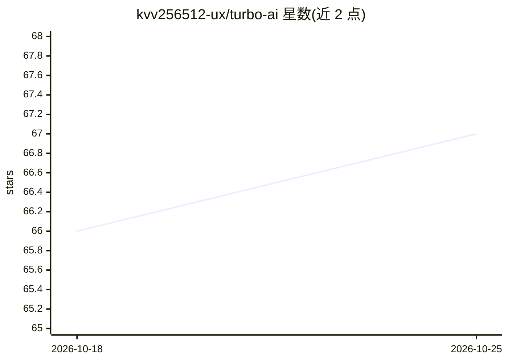

# kvv256512-ux/turbo-ai

⭐ 68 · TypeScript · MIT · 推送 2026-09-20 · [GitHub](https://github.com/kvv256512-ux/turbo-ai) · 个人维护

**Turbo Pascal 7.0 风格的 Pi coding agent 终端前端**

面向使用 Pi coding agent 的开发者，以 Turbo Pascal 7.0 / Borland DOS 风格 TUI 封装 Pi：以 RPC 模式（pi --mode rpc）启动 Pi 并通过其 JSONL 协议驱动，提供 10 菜单栏、项目树、Diff 查看器、会话选择与恢复、多提供商自定义模型管理与 API key 配置、推理力度切换及 PLAN/BUILD 模式。纯前端架构，不修改 Pi 本身；UI 引擎零运行时依赖，直接以 TypeScript + ANSI 转义码实现。需要 Node.js >=20 与已安装的 Pi（>=0.78.0）。当前窗口位置不保存、尚不支持独立多会话窗口。

## 筛选速览

| 维度 | 判定 | 备注 |
|---|---|---|
| AI 角色 | `ai-ecosystem` | LLM/agent 周边工具 |
| 许可风险 | `permissive` | MIT |
| 部署形态 | `None` |  |
| 模型依赖 | — | README 未给出锁定关系 |
| 硬件要求 | — | 无带数字的原话,不猜 |
| 安装摩擦 | `low` | 无编译、无系统依赖或容器化 |
| 成熟度 | `idea` | |

## 能力要点

- 以 JSONL RPC 协议驱动 Pi，纯前端架构，不修改 Pi 本身
- 10 菜单栏 + 重叠窗口的 Turbo Pascal 7.0 风格 TUI，完整鼠标/热键支持
- 跨 10 个提供商（openrouter/deepseek/google/anthropic/openai 等）的自定义模型管理与 API key 配置
- F5 推理力度切换、F6 PLAN/BUILD 模式、F7 Git Diff、F8/F9 测试与构建

## 适用场景

- 以复古 Borland IDE 界面操作 Pi coding agent 进行编码
- 在统一 TUI 中管理多个 AI 提供商的模型与 API key
- 浏览/恢复历史会话并查看 Git 变更与测试构建结果

## 场景标签

`编码 Agent` · 领域:编码与开发

## 证据(README 行号)

> L7: **Turbo-AI** is an authentic Turbo Pascal 7.0 / Borland DOS inspired Terminal UI (TUI) frontend for the **Pi coding 
> L126: - **Pure Frontend Architecture**: Pi is never modified or forked; Turbo-AI drives Pi strictly via the documented J

## 星数曲线

2026-10-18 66 → 2026-10-25 67（+1）

---
*卡片 v1 · prompt 1.4 · 生成 2026-10-24 · 置信度 high · 依据 README sha `6b1150bba842` · [字段定义](../../DATASET.md)*
