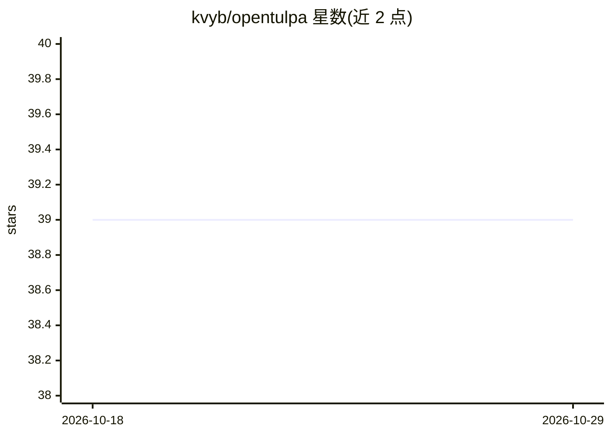

# kvyb/opentulpa

⭐ 39 · Python · MIT · 推送 2026-09-03 · [GitHub](https://github.com/kvyb/opentulpa) · 个人维护

**自我改写源码以适配特定用途的自托管 AI agent**

自托管的 Deep Agents 应用：agent 通过 source_read/source_write/source_edit/source_bash 等工具在持久 Git 仓库上编辑自身源码，激活前提交并记录到 SQLite 激活日志，由 Deep Agent 审查者检查运行部署，通过则激活候选提交、拒绝则回滚到上一健康版本。宿主控制器保持不可变，可本地、Docker Compose 或 Railway 部署；源码编辑按受信设计，面向个人或单租户场景。需要 Git、curl 与模型 API key。

## 筛选速览

| 维度 | 判定 | 备注 |
|---|---|---|
| AI 角色 | `ai-native` | 本体是模型或模型工具 |
| 许可风险 | `permissive` | MIT |
| 部署形态 | `self-host` | docker 或自建部署 |
| 模型依赖 | — | README 未给出锁定关系 |
| 硬件要求 | — | 无带数字的原话,不猜 |
| 安装摩擦 | `low` | 无编译、无系统依赖或容器化 |
| 成熟度 | — | 结构信号不足 |

## 能力要点

- agent 通过 Git 工具集编辑自身源码并保持持久仓库
- SQLite 激活日志 + 审查者审批 + 一键回滚的自演化流程
- 不可变宿主控制器与按精确 commit 选择的子进程运行
- 支持本地、Docker Compose 与 Railway 部署

## 适用场景

- 让 agent 针对我的具体用途持续修改并改进自身代码
- 个人或单租户部署一个可自我演化的自动化 agent
- 在出问题时回滚到上一个健康版本

## 场景标签

`编码 Agent` · 领域:编码与开发

## 证据(README 行号)

> L3: OpenTulpa is a self-hosted Deep Agents application that can edit, activate, and roll back
> L42: 1. `source_read`, `source_write`, `source_edit`, and `source_bash` operate on one persistent,

## 星数曲线

2026-10-18 39 → 2026-10-29 39（+0）

---
*卡片 v1 · prompt 1.4 · 生成 2026-10-25 · 置信度 high · 依据 README sha `5f183e6ab8db` · [字段定义](../../DATASET.md)*
