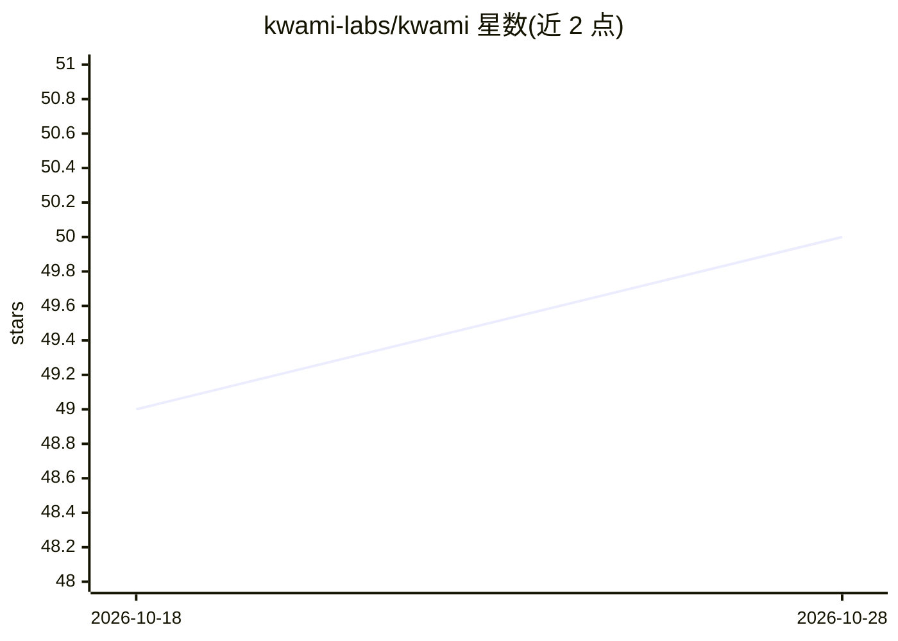

# kwami-labs/kwami

⭐ 50 · TypeScript · Apache-2.0 · 推送 2026-10-26 · [GitHub](https://github.com/kwami-labs/kwami) · [官网](https://kwami.io) · 个人维护

**浏览器 3D AI 伴侣库：WebGL 虚拟形象+语音+记忆+工具**

TypeScript ESM 库，面向在网页中构建 3D AI 伴侣的开发者。每个 Kwami 实例包含 WebGL 头像（blob/black-hole/particles/iris，本地渲染）、基于 LiveKit 的语音管线（STT/LLM/TTS 或 realtime）、性格 Soul 配置、Zep 长期记忆适配器、MCP 工具接入与页内 Skills。头像无需后端即可挂载；语音、记忆与工具调度需自建 token endpoint 与 LiveKit agent，库不托管这些服务。API key 须留在服务端，页面卸载需显式 dispose 释放 WebGL 上下文与 LiveKit 房间。

## 筛选速览

| 维度 | 判定 | 备注 |
|---|---|---|
| AI 角色 | `ai-ecosystem` | LLM/agent 周边工具 |
| 许可风险 | `permissive` | Apache-2.0 |
| 部署形态 | `library` | 以包/库形式分发 |
| 模型依赖 | — | README 未给出锁定关系 |
| 硬件要求 | — | 无带数字的原话,不猜 |
| 安装摩擦 | `low` | 无编译、无系统依赖或容器化 |
| 成熟度 | — | 结构信号不足 |

## 能力要点

- 四种 WebGL 头像渲染器，含皮肤、预设与音频反应动效
- 语音管线支持 STT/LLM/TTS 组合或 realtime，经 LiveKit 调度
- Provider 目录含 Deepgram、OpenAI、Anthropic、Gemini、ElevenLabs、Groq 等
- MCP 工具接入与页内原生 Skills 注册

## 适用场景

- 在网页中嵌入会说话、有记忆的 3D AI 伴侣
- 为对话式产品添加实时反应的虚拟形象
- 通过 MCP 让页面内 AI 伴侣调用外部工具

## 场景标签

`语音 Agent` `Agent 记忆` · 领域:Agent 开发

## 证据(README 行号)

> L48: **Kwami** is a browser TypeScript library for 3D AI companions. Drop a canvas on the page, give the companion a sou
> L63: |**Agent**|Voice pipeline over LiveKit — STT, LLM, TTS, or realtime|
> L87: - **MCP tools** — connect Model Context Protocol servers and expose their tools to the agent

## 星数曲线

2026-10-18 49 → 2026-10-28 50（+1）

---
*卡片 v1 · prompt 1.4 · 生成 2026-10-24 · 置信度 high · 依据 README sha `5ce1734d032c` · [字段定义](../../DATASET.md)*
