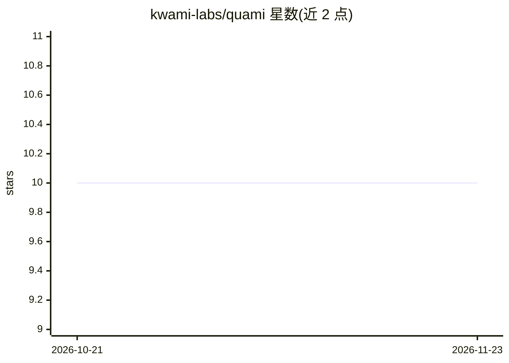

# kwami-labs/quami

⭐ 10 · Vue · NOASSERTION · 推送 2026-11-16 · [GitHub](https://github.com/kwami-labs/quami) · [官网](https://quami.io) · 个人维护

**以 3D AI 伴生体为中心、连接主流应用的 Web OS**

Quami 是一个 Web OS 应用层，将独立的 Kwami 3D AI 引擎（可定制变形 blob）作为中心，通过隐私优先的应用连接器（含 MCP）接入主流应用，提供语音交互（TTS/STT）、可定制外观、多语言 UI 与 Supabase 邮箱认证。基于 Nuxt.js 4 + Three.js，Kwami 以 git 子模块集成，UI 组件来自 @alexcolls/nuxt-ux。项目开发中，AI 交互部分标注为 Coming Soon，路线图显示 2026 年 7 月公共 Alpha；采用双许可，商业使用需另行获取许可。

## 筛选速览

| 维度 | 判定 | 备注 |
|---|---|---|
| AI 角色 | `ai-native` | 本体是模型或模型工具 |
| 许可风险 | `none` | NOASSERTION |
| 部署形态 | `None` |  |
| 模型依赖 | — | README 未给出锁定关系 |
| 硬件要求 | — | 无带数字的原话,不猜 |
| 安装摩擦 | `low` | 无编译、无系统依赖或容器化 |
| 成熟度 | `idea` | |

## 能力要点

- 集成 Kwami 3D 引擎，支持变形 blob 实时渲染与音频反应动画
- 语音交互链路：语音识别输入 + ElevenLabs 文本转语音（标注 Coming Soon）
- 通过隐私优先的连接器（含 MCP）接入主流应用
- 支持 Bun/Deno/Node.js 三种运行时，67+ 复用 UI 组件

## 适用场景

- 在浏览器中以类 OS 界面访问和操作主流应用
- 定制专属 3D AI 伴生体的外观与交互
- 需要匿名、按权限授权的数据访问交互场景

## 场景标签

`AI 助手` · 领域:对话与助手

## 证据(README 行号)

> L10: Quami is a Web OS that integrates Kwami—a fully customizable 3D AI (blob) with conversational AI and an MCP app con
> L18: Quami provides an immersive 3D experience featuring an AI companion with:
> L221: ### 🤖 AI Interaction (Coming Soon)

## 星数曲线

2026-10-21 10 → 2026-11-23 10（+0）

---
*卡片 v1 · prompt 1.4 · 生成 2026-11-19 · 置信度 high · 依据 README sha `a5b0672e676c` · [字段定义](../../DATASET.md)*
