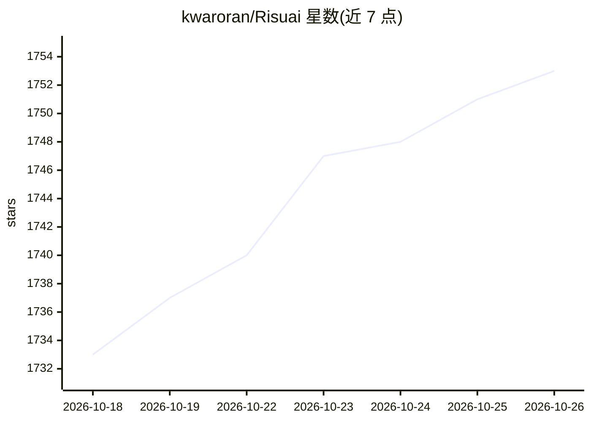

# kwaroran/Risuai

⭐ 1,753 · TypeScript · GPL-3.0 · 推送 2026-10-22 · [GitHub](https://github.com/kwaroran/Risuai) · [官网](https://risuai.net) · 个人维护

**面向终端用户的跨平台 LLM 角色扮演聊天软件**

基于 Svelte/TypeScript/Tauri 的跨平台 AI 聊天软件与 Web 应用，用于 LLM 角色扮演。支持 OpenAI、Claude、Gemini、OpenRouter 等多种 API 接入；提供群聊多角色、情绪图片、正则脚本改写输出、Lorebook 世界书、TTS、自动翻译、HypaMemoryV2/V3 与 SupaMemory 长期记忆、插件扩展等功能。通过官网或 GitHub Releases 安装，也可用 Docker 自托管 Web 版访问 localhost:6001；开发需 Node.js 20.19+/22.12+ 与 pnpm。

## 筛选速览

| 维度 | 判定 | 备注 |
|---|---|---|
| AI 角色 | `ai-native` | 本体是模型或模型工具 |
| 许可风险 | `viral` | GPL-3.0 |
| 部署形态 | `self-host` | docker 或自建部署 |
| 模型依赖 | locked-api |  |
| 硬件要求 | — | 无带数字的原话,不猜 |
| 安装摩擦 | `low` | 无编译、无系统依赖或容器化 |
| 成熟度 | `idea` | |

## 能力要点

- 多 API 接入：OpenAI、Claude、Gemini、OpenRouter 等
- 正则脚本改写模型输出、Lorebook 世界书与群聊多角色
- HypaMemoryV2/V3、SupaMemory 长期记忆系统
- 插件机制可添加自定义功能与 provider

## 适用场景

- 与多个 LLM 角色扮演角色进行对话
- 通过群聊让多个角色同场互动
- 自托管 Web 版供团队或社区使用

## 场景标签

`聊天机器人` · 领域:对话与助手

## 证据(README 行号)

> L7: Risuai, or Risu for short, is a cross platform AI chatting software / web application with powerful features such as
> L18: - **Multiple API Supports**: Supports OpenAI, Claude, Gemini, DeepInfra, Ooba, OpenRouter... and More!

## 星数曲线

2026-10-18 1,733 → 2026-10-26 1,753（+20）

---
*卡片 v1 · prompt 1.4 · 生成 2026-10-21 · 置信度 high · 依据 README sha `1763132ba487` · [字段定义](../../DATASET.md)*
