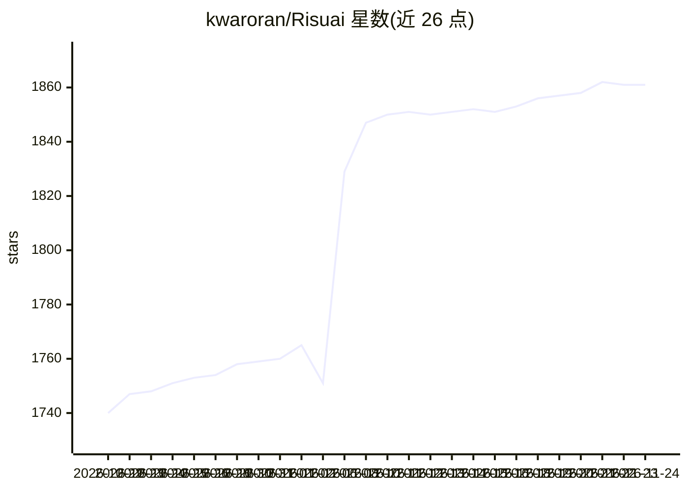

# kwaroran/Risuai

⭐ 1,861 · TypeScript · GPL-3.0 · 推送 2026-11-22 · [GitHub](https://github.com/kwaroran/Risuai) · [官网](https://risuai.net) · 个人维护

**面向用户的跨平台 LLM 角色扮演聊天应用**

基于 Svelte/TypeScript/Tauri/Vite/Tailwind 的跨平台 AI 聊天软件与 Web 应用，面向进行 LLM 角色扮演对话的用户。提供多 API 接入、聊天内资产嵌入、正则脚本、群聊、Lorebook 记忆、TTS 语音、自动翻译、HypaMemoryV2/V3 与 SupaMemory 长期记忆压缩等功能。用户通过官网或 GitHub Releases 安装，也可用 Docker 部署 Web 版（本地访问 6001 端口）。开发需 Node.js 22.13+ 与 pnpm。

## 筛选速览

| 维度 | 判定 | 备注 |
|---|---|---|
| AI 角色 | `ai-native` | 本体是模型或模型工具 |
| 许可风险 | `viral` | GPL-3.0 |
| 部署形态 | `self-host` | docker 或自建部署 |
| 模型依赖 | — | README 未给出锁定关系 |
| 硬件要求 | — | 无带数字的原话,不猜 |
| 安装摩擦 | `low` | 无编译、无系统依赖或容器化 |
| 成熟度 | — | 结构信号不足 |

## 能力要点

- 支持 OpenAI、Claude、Gemini、DeepInfra、Ooba、OpenRouter 等多个 API
- HypaMemoryV2/V3 与 SupaMemory 长期记忆与上下文管理
- 群聊、情绪图片、正则脚本自定义 GUI、插件扩展
- TTS 语音输出与输入输出自动翻译

## 适用场景

- 与多个角色进行 LLM 角色扮演对话
- 在一个聊天里让多个角色群聊互动
- 用 Lorebook 与长期记忆维持长对话设定
- 跨平台或自托管 Web 端使用聊天应用

## 场景标签

`聊天机器人` `语音合成` · 领域:对话与助手

## 证据(README 行号)

> L7: Risuai, or Risu for short, is a cross platform AI chatting software / web application with powerful features such as
> L18: - **Multiple API Supports**: Supports OpenAI, Claude, Gemini, DeepInfra, Ooba, OpenRouter... and More!

## 星数曲线

2026-10-22 1,740 → 2026-11-24 1,861（+121）

---
*卡片 v1 · prompt 1.4 · 生成 2026-11-23 · 置信度 high · 依据 README sha `175a1bf7428f` · [字段定义](../../DATASET.md)*
