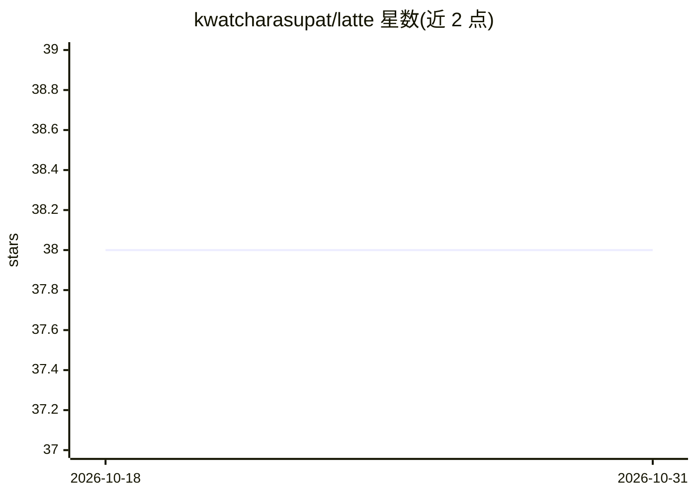

# kwatcharasupat/latte

⭐ 38 · Python · MIT · 推送 2026-08-02 · [GitHub](https://github.com/kwatcharasupat/latte) · [官网](https://latte.readthedocs.io/en/latest) · 个人维护

**面向研究者的潜变量生成模型评测 Python 库**

Latte（LATent Tensor Evaluation）是跨框架的 Python 评测包，用于计算潜变量生成模型的解耦度与可控性指标。提供四种 API 形态：纯 numpy 的 Functional API、Modular API，以及 TorchMetrics 与 Keras Metric 封装，覆盖 PyTorch 与 TensorFlow 两个生态。指标按状态标注（Beta/Stable/开发中/排队中），当前 Beta 指标含 MIG、DMIG、XMIG、DLIG、SAP、Modularity、Smoothness、Monotonicity 等；多数指标已实现，β-VAE Score、FactorVAE Score、DCI 等尚在队列。通过 PyPI 安装，附 Morpho-MNIST Colab 示例与 readthedocs 文档。核心依赖仅 numpy，框架封装为可选安装。

## 筛选速览

| 维度 | 判定 | 备注 |
|---|---|---|
| AI 角色 | `ai-ecosystem` | LLM/agent 周边工具 |
| 许可风险 | `permissive` | MIT |
| 部署形态 | `library` | 以包/库形式分发 |
| 模型依赖 | — | README 未给出锁定关系 |
| 硬件要求 | — | 无带数字的原话,不猜 |
| 安装摩擦 | `low` | 无编译、无系统依赖或容器化 |
| 成熟度 | `idea` | |

## 能力要点

- 跨框架：同一指标提供 Functional/Modular/TorchMetrics/Keras 四种 API
- 覆盖解耦度（MIG/DMIG/XMIG/DLIG/SAP/Modularity）与插值平滑度/单调性等指标
- 核心仅依赖 numpy，torch/tensorflow 封装按需安装
- 提供 Dependency-aware Disentanglement 与 LIAD-based Interpolatability 指标捆绑模块

## 适用场景

- 评测 VAE 等潜变量生成模型的表征解耦程度
- 在 PyTorch 或 TensorFlow 训练流程中集成解耦度指标监控
- 复现与对比多篇解耦度评测指标的论文实验

## 场景标签

`模型评测` · 领域:评测与运维

## 证据(README 行号)

> L22: Latte (for _LATent Tensor Evaluation_) is a cross-framework Python package for evaluation of latent-based generativ
> L9:  Cross-framework Python Package for Evaluation of Latent-based Generative Models

## 星数曲线

2026-10-18 38 → 2026-10-31 38（+0）

---
*卡片 v1 · prompt 1.4 · 生成 2026-10-25 · 置信度 high · 依据 README sha `2e17017a4b67` · [字段定义](../../DATASET.md)*
