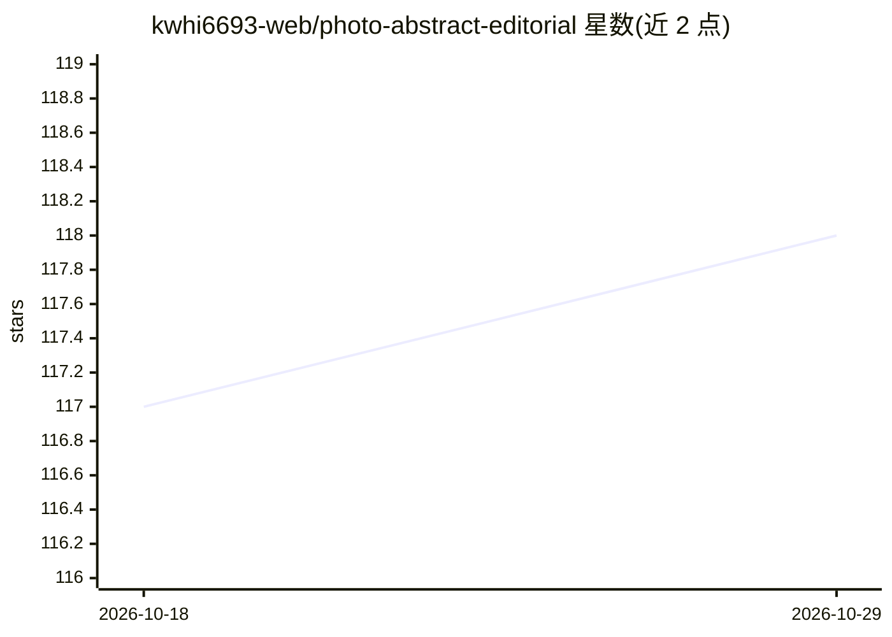

# kwhi6693-web/photo-abstract-editorial

⭐ 118 · Python · AGPL-3.0 · 推送 2026-10-25 · [GitHub](https://github.com/kwhi6693-web/photo-abstract-editorial) · 个人维护 · 中文 README

**把照片转成忠实于原图的编辑式艺术作品的 Agent Skill**

面向 Codex 等 agent 宿主的图片编辑 Skill：读取一张源照片，保留像素级照片区域，生成源派生的克制抽象面板与本地排版的编辑标题，组成编辑式成品。提供 Original 与 V3 Adaptive 两个版本：V3 支持能力路由（Strict Fidelity / Native Image Edit / Reference Generation）、四项 0–100 创作控制、7 种场景画像、5 种布局、8 维 QA 与机器校验器。Strict 保证仅在具备视觉理解、图像生成、本地文件访问、Python 与 Pillow 等能力的宿主上成立；Original 版仅限 Codex。

## 筛选速览

| 维度 | 判定 | 备注 |
|---|---|---|
| AI 角色 | `ai-native` | 本体是模型或模型工具 |
| 许可风险 | `viral` | AGPL-3.0 |
| 部署形态 | `desktop` | 安装包/桌面程序 |
| 模型依赖 | — | README 未给出锁定关系 |
| 硬件要求 | — | 无带数字的原话,不猜 |
| 安装摩擦 | `low` | 无编译、无系统依赖或容器化 |
| 成熟度 | — | 结构信号不足 |

## 能力要点

- V3 能力路由：Strict Fidelity / Native Image Edit / Reference Generation 三种模式
- 四项创作控制（Abstraction/Creative Freedom/Identity Preservation/Spatial Fidelity，各 0–100）
- Strict Fidelity 路径提供像素级照片区域校验、manifest 与机器校验器
- 7 种场景画像与 5 种确定性布局画像

## 适用场景

- 把人像、风景、建筑等照片转成带抽象面板的编辑式作品
- 按 0–100 参数控制抽象程度与主体保真度
- 系列作品保持统一视觉风格（Series Style Lock）

## 场景标签

`图像视频处理` `图像生成` · 领域:内容生成

## 证据(README 行号)

> L3: A source-faithful Agent Skill that turns photographs into editorial artworks with adaptive layouts, controlled abstr
> L164: - Capability-based routing across Strict Fidelity, Native Image Edit, and Reference Generation.
> L178: When the host has visual understanding, image generation, local file access, Python, Pillow-compatible processing,

## 星数曲线

2026-10-18 117 → 2026-10-29 118（+1）

---
*卡片 v1 · prompt 1.4 · 生成 2026-10-23 · 置信度 mid · 依据 README sha `829d219ac7df` · [字段定义](../../DATASET.md)*
