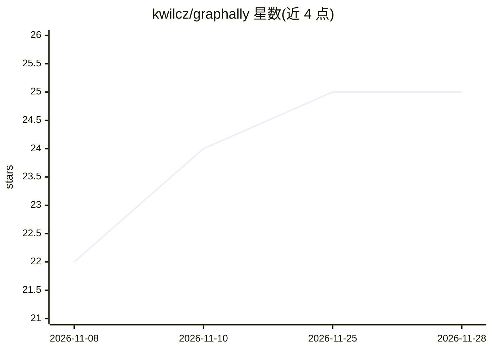

# kwilcz/graphally

⭐ 25 · JavaScript · Apache-2.0 · 推送 2026-11-27 · [GitHub](https://github.com/kwilcz/graphally) · 个人维护

**让 AI agent 生成可编辑 SVG 技术架构图的技能与渲染引擎**

面向 agent 的技能包（skill）加渲染引擎：agent 以 HTML+CSS+JSON 连接列表描述图（架构图、AWS/Azure 图标、网络、BPMN、时序、甘特等，并可从 Terraform 仓库起草），graphally 在浏览器中布局、布线并输出 SVG/PNG，无需手写坐标。提供五种安装途径（Claude Code 插件、GitHub CLI、Copilot CLI、skills CLI、Claude.ai/Desktop 上传 zip），引擎另以 npm 包 graphally 提供 CLI 与 Node API 供无 agent 的流水线使用。运行需 Node.js 18+ 与 Chrome/Chromium/Edge。

## 筛选速览

| 维度 | 判定 | 备注 |
|---|---|---|
| AI 角色 | `ai-ecosystem` | LLM/agent 周边工具 |
| 许可风险 | `permissive` | Apache-2.0 |
| 部署形态 | `desktop` | 安装包/桌面程序 |
| 模型依赖 | — | README 未给出锁定关系 |
| 硬件要求 | — | 无带数字的原话,不猜 |
| 安装摩擦 | `low` | 无编译、无系统依赖或容器化 |
| 成熟度 | — | 结构信号不足 |

## 能力要点

- agent 写 HTML/CSS/JSON 源，引擎自动布局布线输出 SVG/PNG，无坐标
- 支持架构（Azure/AWS 图标）、网络、BPMN、时序、甘特等，并可从 Terraform 代码起草
- 同一源文件输出明暗双主题，源文件即网页可直接打开编辑
- 引擎独立发布为 npm 包，提供 CLI 与 Node API

## 适用场景

- 让 Claude Code/Copilot/Cursor 等 agent 按一句话需求画出服务架构图
- 从 Terraform 仓库生成基础设施图
- 在 CI 或工具流水线中用 npx graphally 批量渲染图表

## 场景标签

 · 领域:开发者工具/图表生成

## 证据(README 行号)

> L5: An agent skill and the engine behind it. Your agent writes the diagram as a small web
> L44: The skill is self-contained: one folder with its instructions, scripts and assets. It
> L146: The engine is also the npm package `graphally`, for tools, pipelines and CI without an

## 星数曲线

2026-11-08 22 → 2026-11-28 25（+3）

---
*卡片 v1 · prompt 1.4 · 生成 2026-11-18 · 置信度 high · 依据 README sha `be5b96934c14` · [字段定义](../../DATASET.md)*
