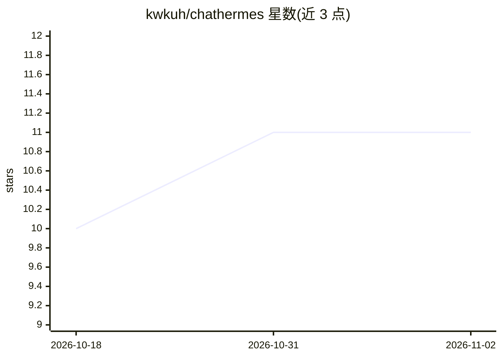

# kwkuh/chathermes

⭐ 11 · TypeScript · NOASSERTION · 推送 2026-07-31 · [GitHub](https://github.com/kwkuh/chathermes) · [官网](https://chathermes.com) · 组织维护

**自托管多租户 Agent SaaS 模板：基于 Hermes Agent 构建平台**

开源的多租户 SaaS 样板工程，构建在 Nous Research 的 Hermes Agent 之上：为付费用户自动分配独立 Agent 实例（Hetzner 专用服务器），免费用户共享 OpenAI 兼容代理；提供 magic-link 认证、Stripe 订阅与积分计费、14 个聊天工具（搜索/浏览/记忆/Telegram/图像生成等）、持久记忆、vibe coding 发布公开 URL、REST API 与管理面板。技术栈为 Next.js + Hono/Bun + 单 SQLite 文件，通过 install.sh 或 Docker Compose 一键运行，需自备 LLM API key。

## 筛选速览

| 维度 | 判定 | 备注 |
|---|---|---|
| AI 角色 | `ai-ecosystem` | LLM/agent 周边工具 |
| 许可风险 | `none` | NOASSERTION |
| 部署形态 | `self-host` | docker 或自建部署 |
| 模型依赖 | — | README 未给出锁定关系 |
| 硬件要求 | — | 无带数字的原话,不猜 |
| 安装摩擦 | `low` | 无编译、无系统依赖或容器化 |
| 成熟度 | — | 结构信号不足 |

## 能力要点

- 付费用户自动开通专属 Hermes Agent 实例（Hetzner，默认需管理员批准）
- 14 个聊天时工具：搜索/浏览/记忆/Telegram/图像生成/子 agent 调度等
- Stripe 订阅与积分包计费、magic-link 认证、多租户管理面板
- 单 SQLite 文件 + 三个 Bun 进程，无需 PostgreSQL/Redis/Kafka

## 适用场景

- 快速搭建自托管的多租户 AI agent SaaS 产品
- 团队内部私有化部署 Hermes Agent 平台
- 在 VPS 上一键部署带计费的 agent 服务平台

## 场景标签

`Agent 框架` · 领域:Agent 开发

## 证据(README 行号)

> L10: > Open-source, **self-hosted**, multi-tenant SaaS boilerplate on top of Nous Research's Hermes Agent. Clone it, run
> L12: > **Searching for `hermes-agent`?** This is the production reference: a multi-tenant SaaS that provisions a dedicat
> L44: - **Shared agent proxy** — Bun OpenAI-compatible proxy on `:19002` for all free-tier users

## 星数曲线

2026-10-18 10 → 2026-11-02 11（+1）

---
*卡片 v1 · prompt 1.4 · 生成 2026-11-02 · 置信度 high · 依据 README sha `8a2eba33973a` · [字段定义](../../DATASET.md)*
