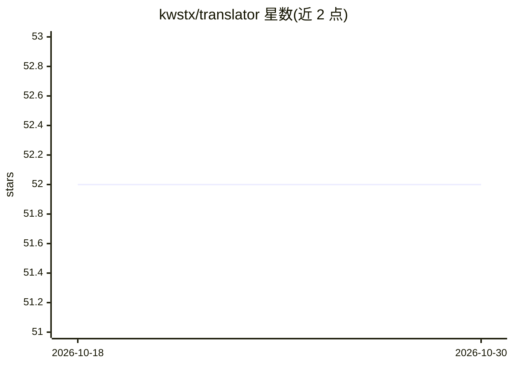

# kwstx/translator

⭐ 52 · Python · MIT · 推送 2026-04-13 · [GitHub](https://github.com/kwstx/translator) · [官网](https://www.useengram.com/) · 个人维护

**AI agent 工具集成层：统一注册 API/CLI 并自愈协议转换**

名为 Engram 的语义互操作层，位于 AI agent 与工具之间：注册任意 API、OpenAPI、GraphQL 或 CLI 工具后，自动生成 MCP 与 CLI 两种工具表示，按性能加权在 MCP 与 CLI 后端间路由，并用 OWL 本体与 ML 检测并修复 schema 漂移。支持 MCP、A2A、ACP 协议间的转换与多跳交接，提供统一 EAT 身份与权限模型、ControlPlane/Step/GlobalData 的 SDK 用于构建确定性多步 agent 工作流。通过 curl 安装脚本安装 engram CLI（Linux/macOS/WSL2），面向需要在真实系统上运行 agent 的开发者。

## 筛选速览

| 维度 | 判定 | 备注 |
|---|---|---|
| AI 角色 | `ai-ecosystem` | LLM/agent 周边工具 |
| 许可风险 | `permissive` | MIT |
| 部署形态 | `library` | 以包/库形式分发 |
| 模型依赖 | — | README 未给出锁定关系 |
| 硬件要求 | — | 无带数字的原话,不猜 |
| 安装摩擦 | `low` | 无编译、无系统依赖或容器化 |
| 成熟度 | — | 结构信号不足 |

## 能力要点

- 注册一次即可从任意 API/CLI 生成 MCP 与 CLI 工具表示
- OWL 本体 + ML 的 schema 漂移检测与自动修复
- MCP 与 CLI 双后端的性能加权智能路由
- SDK 提供 ControlPlane 确定性多步工作流与 LLM 外部状态存储

## 适用场景

- 让 agent 接入现有 API 和 CLI 工具而无需编写胶水代码
- 多步 agent 工作流中强制执行固定的执行顺序，防止跳步
- API 变更后维持工具集成持续可用
- 跨 MCP/A2A/ACP 协议的 agent 协作与请求交接

## 场景标签

`Agent 框架` · 领域:Agent 开发

## 证据(README 行号)

> L5: The adaptive semantic interoperability layer for AI agents. Connect **anything** — any API, any system, any protocol
> L17: - Translates between MCP, CLI, A2A, and ACP with multi-hop handoffs when needed.
> L51: 1. **Governed Sequencing (Primary Pattern)**: Define strict, deterministic multi-step workflows using the `ControlP

## 星数曲线

2026-10-18 52 → 2026-10-30 52（+0）

---
*卡片 v1 · prompt 1.4 · 生成 2026-10-24 · 置信度 mid · 依据 README sha `6b8e4f4d3388` · [字段定义](../../DATASET.md)*
