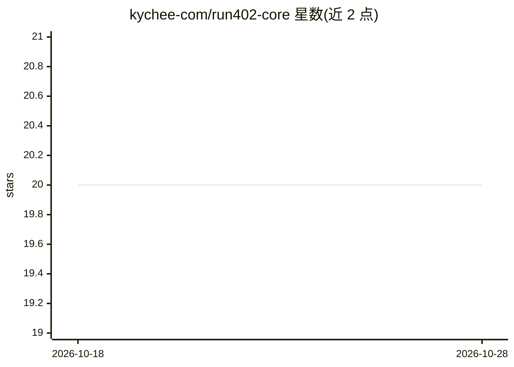

# kychee-com/run402-core

⭐ 20 · TypeScript · Apache-2.0 · 推送 2026-10-27 · [GitHub](https://github.com/kychee-com/run402-core) · [官网](https://run402.com) · 组织维护

**AI agent 的自托管后端运行时核心：数据库/存储/函数/路由**

Run402 托管云的开源自托管切片：为 AI agent 提供 Postgres 数据库、用户认证、文件存储、serverless 函数与站点托管的可自运行部分。当前 runtime-kernel 支持本地项目创建、ReleaseSpec 计划与提交、内联 PostgreSQL 迁移、PostgREST/RLS 行为、静态内容服务、本地存储对象与路由清单、可信本地函数（含持久函数运行与单节点定时触发）、Astro SSR 及可移植项目归档导入。不包含云端控制平面、权限图、计费与运维能力。附 docker-compose 本地栈，经 CLI/SDK/MCP/API 操作。

## 筛选速览

| 维度 | 判定 | 备注 |
|---|---|---|
| AI 角色 | `ai-ecosystem` | LLM/agent 周边工具 |
| 许可风险 | `permissive` | Apache-2.0 |
| 部署形态 | `library` | 以包/库形式分发 |
| 模型依赖 | — | README 未给出锁定关系 |
| 硬件要求 | — | 无带数字的原话,不猜 |
| 安装摩擦 | `low` | 无编译、无系统依赖或容器化 |
| 成熟度 | `idea` | |

## 能力要点

- runtime-kernel 支持 Postgres 迁移、PostgREST/RLS、静态内容与本地存储路由
- 可信本地函数执行：持久函数运行与单节点定时触发
- 可验证的可移植项目归档（Cloud 导出→Core 导入）
- docker-compose 提供 Core/Postgres/PostgREST 本地栈

## 适用场景

- 把 Run402 应用的运行时切片部署到自己机器上自托管
- 通过 CLI/SDK/MCP 为 agent 提供数据库、存储与函数后端
- 验证 Cloud 项目到自托管环境的可移植性

## 场景标签

 · 领域:AI agent 基础设施/后端服务

## 证据(README 行号)

> L3: Run402 Core is the open-source, self-hostable server and runtime core for
> L4: Run402 — backend infrastructure for AI agents. Run402 gives an
> L10: The current Core runtime-kernel slice is an Apache-2.0 self-hosting runtime. It can create a local project, plan an

## 星数曲线

2026-10-18 20 → 2026-10-28 20（+0）

---
*卡片 v1 · prompt 1.4 · 生成 2026-10-28 · 置信度 high · 依据 README sha `4a2a5659e942` · [字段定义](../../DATASET.md)*
