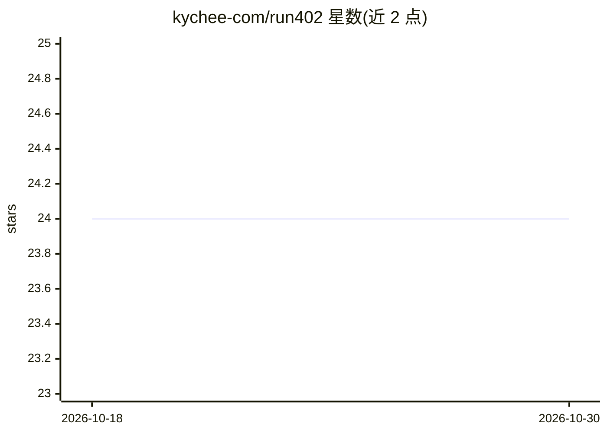

# kychee-com/run402

⭐ 24 · TypeScript · MIT · 推送 2026-10-29 · [GitHub](https://github.com/kychee-com/run402) · [官网](https://run402.com) · 组织维护

**面向 AI agent 的后端基础设施：数据库/认证/存储/函数由 agent 自助开通与付费**

开源的后端即服务（backend-as-a-service），设计上供自主 agent 通过 CLI、TypeScript SDK 与 MCP 服务器直接驱动：一次调用开通 Postgres 数据库、REST API、用户认证、内容寻址文件存储、静态站点托管、serverless 函数与图像生成，并经单一分阶段部署流程发布。用量以 x402（Base 上 USDC）或 MPP（pathUSD/比特币闪电网络）支付，测试网原型层免费。由 Kychee 公司维护，本仓库为 MIT，可自托管的 run402-core 运行时为 Apache-2.0，托管云控制面为专有。

## 筛选速览

| 维度 | 判定 | 备注 |
|---|---|---|
| AI 角色 | `ai-ecosystem` | LLM/agent 周边工具 |
| 许可风险 | `permissive` | MIT |
| 部署形态 | `library` | 以包/库形式分发 |
| 模型依赖 | — | README 未给出锁定关系 |
| 硬件要求 | — | 无带数字的原话,不猜 |
| 安装摩擦 | `medium` | 含编译或系统依赖之一 |
| 成熟度 | — | 结构信号不足 |

## 能力要点

- CLI/SDK/MCP/OpenClaw skill 四类接口共享同一类型化内核 @run402/sdk
- x402/MPP 微支付（USDC on Base、pathUSD、Lightning sats）及卡充额度，测试网免费
- 表默认不可经 /rest/v1 访问，需 manifest 显式暴露以避免 RLS 泄漏
- 部署前本地校验所有 manifest 引用文件（MANIFEST_FILE_MISSING 等类型化错误）

## 适用场景

- 让编码 agent 无需登录控制台即可开通并部署全栈后端
- 通过 MCP 让 Claude Desktop/Cursor/Cline 管理 run402 资源
- 用 CLI/SDK 编写脚本化部署与 CI 工作流
- agent 使用同一钱包向 x402 卖家按次付费调用

## 场景标签

 · 领域:开发者工具/云后端基础设施

## 证据(README 行号)

> L17: **Run402 is open-source backend infrastructure for AI agents and coding agents** — a backend-as-a-service addressed
> L21: One call to run402 gives an agent a full Postgres database, REST API, user auth, content-addressed file storage, st
> L27: **Use the CLI by default** to provision, deploy, inspect and recover. Use the typed, opinionated SDK when writing p

## 星数曲线

2026-10-18 24 → 2026-10-30 24（+0）

---
*卡片 v1 · prompt 1.4 · 生成 2026-10-27 · 置信度 high · 依据 README sha `7bba0048a132` · [字段定义](../../DATASET.md)*
