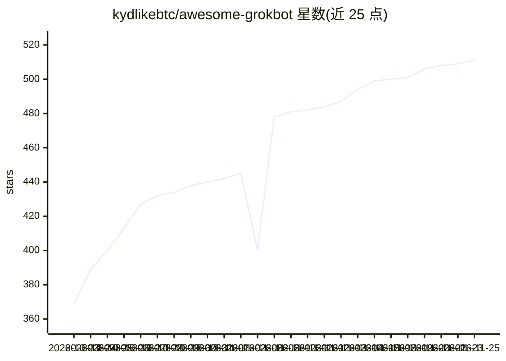

# kydlikebtc/awesome-grokbot

⭐ 511 · Python · NOASSERTION · 推送 2026-11-16 · [GitHub](https://github.com/kydlikebtc/awesome-grokbot) · [官网](https://kydlikebtc.github.io/awesome-grokbot/) · 个人维护 · 中文 README

**Grok Bot 公开分享配置的编目清单：5010 条链接逐条校验、双语可检索**

本仓库不是 Grok Bot 本身、安装器或源码，而是公开 x.ai/bot 分享链接的索引：由四个上游社区目录合并去重，按 `x.ai/bot/<id>` 内的 id 作为合并键，配合定时任务每日重检链接，失效链接隔离到 retired.json。全部 5010 行带人工撰写的中文摘要与来源目录归因，并附 JSON schema、CI 校验脚本（check_links.py / lint.py）和一个可搜索、无构建步骤的静态站点，分八个类别（编程、收件箱、研究、销售、财务、内容、个人事务、团队交接）组织。仓库明确声明不验证机器人是否安全，导入前需自行审查。

## 筛选速览

| 维度 | 判定 | 备注 |
|---|---|---|
| AI 角色 | `ai-knowledge` | 知识聚合/清单类 |
| 许可风险 | `none` | NOASSERTION |
| 部署形态 | `None` |  |
| 模型依赖 | — | README 未给出锁定关系 |
| 硬件要求 | — | 无带数字的原话,不猜 |
| 安装摩擦 | `low` | 无编译、无系统依赖或容器化 |
| 成熟度 | — | 结构信号不足 |

## 能力要点

- 5010 条分享链接全部于 2026-11-16 逐条抓取校验，93 条失效链接单独隔离在 retired.json
- 每行标注来源目录，3977 行归属 2+ 上游目录，2136 行附原始帖子链接
- 全部 5010 行配有手写中文摘要，提供 EN/中文双语站点
- 附 schema 校验与链接重扫脚本，方法可复现

## 适用场景

- 想在 Grok Bot 中一键添加社区分享的 AI 队友时先浏览预览
- 按类别（编码/研究/财务/内容等）筛选可用的机器人配置
- 识别并避开已失效的分享链接

## 场景标签

`精选清单` · 领域:学习与行业

## 证据(README 行号)

> L15: > Grok Bot gives named AI teammates their own always-on cloud computer. This repo is not Grok Bot, not an installer
> L203: Reproduce it yourself with `scripts/check_links.py` (re-sweeps every share) and `scripts/lint.py` (validates again

## 星数曲线

2026-10-23 369 → 2026-11-25 511（+142）

---
*卡片 v1 · prompt 1.4 · 生成 2026-11-25 · 置信度 high · 依据 README sha `3ad6772f4af2` · [字段定义](../../DATASET.md)*
