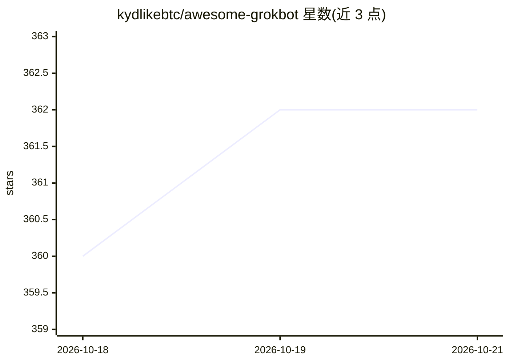

# kydlikebtc/awesome-grokbot

⭐ 369 · Python · NOASSERTION · 推送 2026-10-20 · [GitHub](https://github.com/kydlikebtc/awesome-grokbot) · [官网](https://kydlikebtc.github.io/awesome-grokbot/) · 个人维护 · 中文 README

**Grok Bot 公开分享配置的策展清单（4933 条，双语）**

聚合四个社区目录并做链接校验的 x.ai/bot 分享索引：收录 4933 条在线分享，按八类组织，每条附中文摘要与来源归因，26 条失效链接单独存入 retired.json。由定时任务每日复查并同步上游目录，提供 schema 校验、catalog.json 数据文件与一个可搜索、带筛选的静态站点。仓库本身不是 Grok Bot、不是安装器也不是源码，仅提供索引；导入前附带安全检查清单，并声明链接可达不等于安全。

## 筛选速览

| 维度 | 判定 | 备注 |
|---|---|---|
| AI 角色 | `ai-knowledge` | 知识聚合/清单类 |
| 许可风险 | `none` | NOASSERTION |
| 部署形态 | `None` |  |
| 模型依赖 | — | README 未给出锁定关系 |
| 硬件要求 | — | 无带数字的原话,不猜 |
| 安装摩擦 | `low` | 无编译、无系统依赖或容器化 |
| 成熟度 | — | 结构信号不足 |

## 能力要点

- 4933 条经链接状态校验的 Grok Bot 分享，每条含来源归因与中文摘要
- 定时任务每日复查并与四个上游目录同步
- 26 条失效链接隔离于 retired.json，129 条更名条目保留 aka 别名
- 提供 catalog.json、JSON schema、CI 校验与可搜索的双语静态站点

## 适用场景

- 按类别查找并预览公开分享的 Grok Bot 配置
- 在导入第三方 bot 前核对来源与安全检查清单
- 以 CC0 数据文件为基础构建自己的目录或应用

## 场景标签

`精选清单` · 领域:学习与行业

## 证据(README 行号)

> L15: > Grok Bot gives named AI teammates their own always-on cloud computer. This repo is not Grok Bot, not an installer
> L46: |📦 `catalog.json`|All 4933 live entries, schema-validated|

## 星数曲线

2026-10-18 360 → 2026-10-21 362（+2）

---
*卡片 v1 · prompt 1.4 · 生成 2026-10-22 · 置信度 high · 依据 README sha `f6b3f7ee5cad` · [字段定义](../../DATASET.md)*
