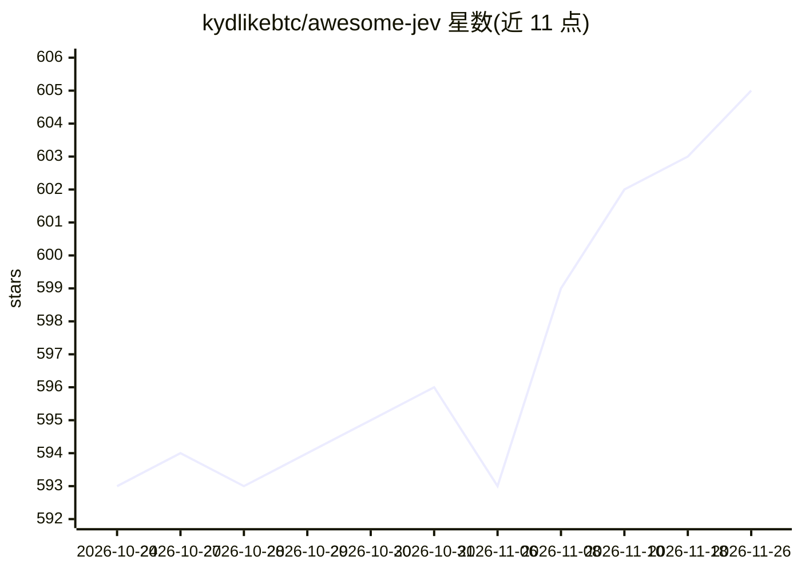

# kydlikebtc/awesome-jev

⭐ 605 · Python · NOASSERTION · 推送 2026-11-25 · [GitHub](https://github.com/kydlikebtc/awesome-jev) · [官网](https://kydlikebtc.github.io/awesome-jev/) · 个人维护

**基于 Jev 决策模型的产品发布榜与公开示例目录**

本仓库是一个发布板叠加目录的结构：发布板部分收录构建于 Jev（TypeSafe AI 决策模型）之上的产品，由作者每周提交、社区在 Discussions 投票并产生排名；目录部分（Jev Decision Atlas）按所解决的决策类型组织公开示例，每条记录引用来源、call-site 引文记录与备注，区分人工阅读与模型阅读。仓库同时记录 Jev 的输入输出原语（Choice/Score/Noul）、上下文限制与兼容性说明。声明非 Jev 产品或 SDK，与 TypeSafe AI 无关联，排名不代表推荐。运行时与性能未经独立测试。

## 筛选速览

| 维度 | 判定 | 备注 |
|---|---|---|
| AI 角色 | `ai-knowledge` | 知识聚合/清单类 |
| 许可风险 | `none` | NOASSERTION |
| 部署形态 | `None` |  |
| 模型依赖 | — | README 未给出锁定关系 |
| 硬件要求 | — | 无带数字的原话,不猜 |
| 安装摩擦 | `low` | 无编译、无系统依赖或容器化 |
| 成熟度 | — | 结构信号不足 |

## 能力要点

- 每周发布流程：周四截止提交、下周一至周日投票、次周一公布排名
- 按决策模式组织的公开示例索引，附来源引用与 call-site 引文记录
- 区分人工阅读与模型阅读 call-site 的证据标记
- 提供 JSON 数据、MCP 服务器工具（launch_board/top_launches）与自托管发布板方式

## 适用场景

- 查找基于 Jev 决策模型构建的公开项目示例
- 把自己基于 Jev 开发的产品提交到每周发布板
- 按决策类型浏览 Jev 的调用场景与调用点证据

## 场景标签

`精选清单` · 领域:学习与行业

## 证据(README 行号)

> L170: - **This repo** is a launch board over a catalogue. The board above: products built on Jev, launched by their make
> L3:  awesome-jev — Jev Launches: 1,329 products built on Jev by 1,158 makers, with 1,445 call-site citation records. Cou
> L174: > Not the product, not an SDK, not affiliated with TypeSafe AI, and not a recommendation. Inclusion is a source re

## 星数曲线

2026-10-24 593 → 2026-11-26 605（+12）

---
*卡片 v1 · prompt 1.4 · 生成 2026-11-25 · 置信度 high · 依据 README sha `85f69e9cede4` · [字段定义](../../DATASET.md)*
