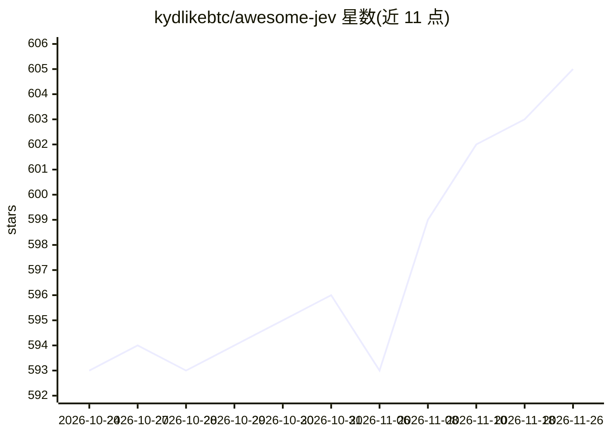

# kydlikebtc/awesome-jev

⭐ 605 · Python · NOASSERTION · 推送 2026-11-25 · [GitHub](https://github.com/kydlikebtc/awesome-jev) · [官网](https://kydlikebtc.github.io/awesome-jev/) · 个人维护 · 中文 README

**Jev 决策模型产品的发布榜与案例目录，附引用核查**

本仓库不是 Jev 本身，而是一个发布榜（launch board）叠加案例目录：收录基于 TypeSafe AI 的 Jev 决策模型构建的产品（当前记录 1,343 个），制作者每周提交发布、社区在 Discussions 投票排名。目录按决策模式组织公开示例，每行记录来源、调用点引用与原始声明，并区分人读过的代码与仅文本信号的情况；榜单独记录投票与证据，二者不相加。README 明确声明与 TypeSafe AI 无隶属，排名不代表运行时或性能背书。

## 筛选速览

| 维度 | 判定 | 备注 |
|---|---|---|
| AI 角色 | `ai-knowledge` | 知识聚合/清单类 |
| 许可风险 | `none` | NOASSERTION |
| 部署形态 | `None` |  |
| 模型依赖 | — | README 未给出锁定关系 |
| 硬件要求 | — | 无带数字的原话,不猜 |
| 安装摩擦 | `low` | 无编译、无系统依赖或容器化 |
| 成熟度 | — | 结构信号不足 |

## 能力要点

- 发布榜：每周提交、投票、排名，60 天后可再次发布
- Jev Decision Atlas：按决策模式组织的公开示例索引
- 调用点引用核查：区分真人读码与仅文本信号
- 提供 JSON 数据、MCP 服务器工具与自托管榜单方法

## 适用场景

- 我基于 Jev 构建了产品，想在发布榜上提交并获取投票
- 我想查找某个决策模式下的 Jev 使用示例并核对来源
- 我想给 agent 内环接入一个 Jev 判层类工具前先看已有案例

## 场景标签

`精选清单` · 领域:学习与行业

## 证据(README 行号)

> L3:  awesome-jev — Jev Launches: 1,343 products built on Jev by 1,170 makers, with 1,460 call-site citation records. Cou
> L170: - **This repo** is a launch board over a catalogue. The board above: products built on Jev, launched by their make
> L173: > [!NOTE]

## 星数曲线

2026-10-24 593 → 2026-11-26 605（+12）

---
*卡片 v1 · prompt 1.4 · 生成 2026-11-26 · 置信度 high · 依据 README sha `281c73473ac2` · [字段定义](../../DATASET.md)*
