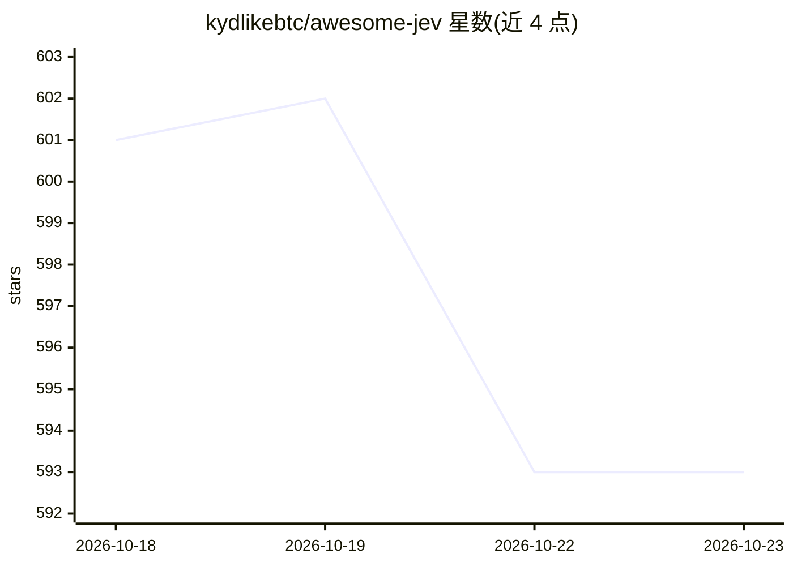

# kydlikebtc/awesome-jev

⭐ 593 · Python · NOASSERTION · 推送 2026-10-21 · [GitHub](https://github.com/kydlikebtc/awesome-jev) · [官网](https://kydlikebtc.github.io/awesome-jev/) · 个人维护 · 中文 README

**Jev 决策模型的公共资源清单：按决策模式索引 1,218 条**

第三方维护的 TypeSafe AI Jev 决策模型资源编目：收录 1,218 个公共资源，含 1,215 条带日期的链接记录与 1,079 条调用点引用记录，按工具选择、上下文压缩、安全门控、分类等 18 种决策模式组织，并提供机器可读的 JSON schema。每条记录标注来源引用与作者自述的测量结论（含不利结果与未采纳案例）。仓库声明不隶属于 TypeSafe AI、未独立测试运行时与性能，Jev 无公开权重不可本地运行。提供双语（EN/中文）浏览站点。

## 筛选速览

| 维度 | 判定 | 备注 |
|---|---|---|
| AI 角色 | `ai-knowledge` | 知识聚合/清单类 |
| 许可风险 | `none` | NOASSERTION |
| 部署形态 | `None` |  |
| 模型依赖 | — | README 未给出锁定关系 |
| 硬件要求 | — | 无带数字的原话,不猜 |
| 安装摩擦 | `low` | 无编译、无系统依赖或容器化 |
| 成熟度 | — | 结构信号不足 |

## 能力要点

- 1,218 条资源按 18 种决策模式索引，全部 18 类均有条目
- 每行记录来源引用、调用点证据与作者自述测量方向（favourable/mixed/unfavourable）
- 专设负面结果区：收录测量后未采纳或移除的案例
- 1,215 条带日期的链接检查记录与 1,079 条调用点引用记录

## 适用场景

- 为 agent 的工具选择、上下文压缩、安全门控等决策环节查找 Jev 用法参考
- 在采纳 Jev 前查阅他人测量的不利结果与已知局限
- 按机器可读 JSON schema 批量读取资源记录

## 场景标签

`精选清单` · 领域:学习与行业

## 证据(README 行号)

> L33: - **Jev** is a decision model from TypeSafe AI. It does not write text — you hand it state plus typed questions and
> L34: - **This repo** indexes public examples of using it, organised by the *decision* being made. The resource you read 
> L38: > Not the product, not an SDK, not affiliated with TypeSafe AI, and not a recommendation. Inclusion is a source rec

## 星数曲线

2026-10-18 601 → 2026-10-23 593（-8）

---
*卡片 v1 · prompt 1.4 · 生成 2026-10-21 · 置信度 high · 依据 README sha `e1f9acd89dc4` · [字段定义](../../DATASET.md)*
