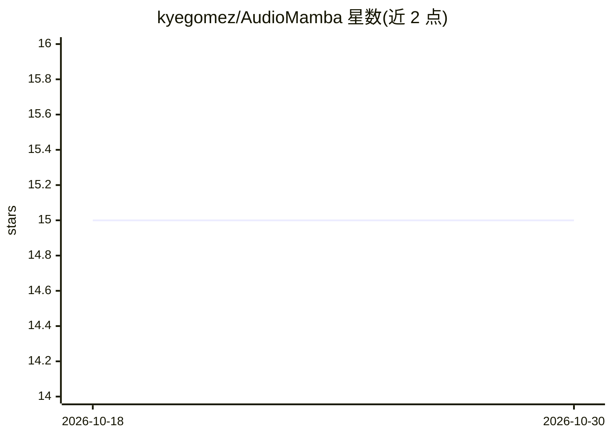

# kyegomez/AudioMamba

⭐ 15 · Shell · MIT · 推送 2026-10-26 · [GitHub](https://github.com/kyegomez/AudioMamba) · [官网](https://github.com/kyegomez/swarms) · 个人维护

**AudioMamba 论文的 PyTorch 实现：音频表示学习**

论文 "Audio Mamba: Bidirectional State Space Model for Audio Representation Learning" 的 PyTorch 实现，属于音频表示学习方向的模型代码库，面向复现论文或在其基础上做研究的开发者。README 内容极少：仅声明 MIT 许可与参考文献条目（论文链接为占位符），未给出安装命令、依赖说明、数据准备或训练/推理示例，使用需直接阅读代码。主题标签含 mamba、transformers、vit、patch，指向双向状态空间模型架构。

## 筛选速览

| 维度 | 判定 | 备注 |
|---|---|---|
| AI 角色 | `ai-native` | 本体是模型或模型工具 |
| 许可风险 | `permissive` | MIT |
| 部署形态 | `None` |  |
| 模型依赖 | — | README 未给出锁定关系 |
| 硬件要求 | — | 无带数字的原话,不猜 |
| 安装摩擦 | `low` | 无编译、无系统依赖或容器化 |
| 成熟度 | — | 结构信号不足 |

## 能力要点

- AudioMamba 双向状态空间模型论文的 PyTorch 实现
- MIT 许可

## 适用场景

- 复现 AudioMamba 论文的音频表示学习实验
- 在双向 SSM 音频模型基础上做研究修改

## 场景标签

 · 领域:音频/深度学习模型实现

## 证据(README 行号)

> L3: # Audio Mamba
> L8: - PAPER LINK

## 星数曲线

2026-10-18 15 → 2026-10-30 15（+0）

---
*卡片 v1 · prompt 1.4 · 生成 2026-10-30 · 置信度 low · 依据 README sha `d6dc90827d5a` · [字段定义](../../DATASET.md)*
