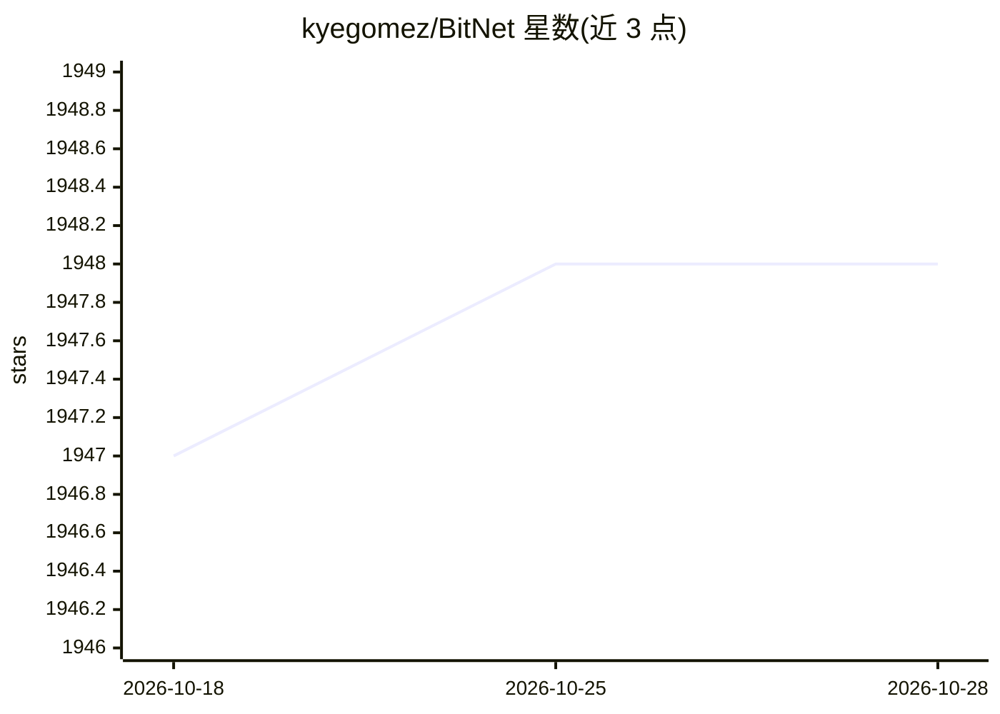

# kyegomez/BitNet

⭐ 1,948 · Python · MIT · 推送 2026-10-26 · [GitHub](https://github.com/kyegomez/BitNet) · [官网](https://discord.gg/qUtxnK2NMf) · 个人维护

**BitNet 论文的 PyTorch 实现：1-bit Transformer 模块库**

用 PyTorch 复现论文《BitNet: Scaling 1-bit Transformers for Large Language Models》的线性方法与模型：BitLinear（layernorm→二值化→abs max 量化→反量化）可替换 nn.Linear，并提供完整 Transformer、BitMGQA 注意力、前馈、BitLora、BitMamba、BitMoE、1-bit ViT 等模块，以及推理类 BitNetInference 生成文本。支持将已有 PyTorch 模型中的线性层批量替换。README 注明需从头训练或微调才能使用 BitLinear，部分 1.5 版组件仍在开发中并存在已知 bug；另提供可选 CUDA 低比特 gemm 内核的编译方式。

## 筛选速览

| 维度 | 判定 | 备注 |
|---|---|---|
| AI 角色 | `ai-native` | 本体是模型或模型工具 |
| 许可风险 | `permissive` | MIT |
| 部署形态 | `library` | 以包/库形式分发 |
| 模型依赖 | — | README 未给出锁定关系 |
| 硬件要求 | — | 无带数字的原话,不猜 |
| 安装摩擦 | `high` | 编译与系统依赖俱全 |
| 成熟度 | `idea` | |

## 能力要点

- BitLinear 模块实现 1-bit 线性替换 nn.Linear
- 完整 BitNetTransformer、BitMGQA 注意力、BitFeedForward 等组件
- BitNetInference 类可加载 checkpoint 并生成文本
- 提供 replace_linears_in_pytorch_model 批量替换已有模型线性层

## 适用场景

- 在 PyTorch 项目中替换线性层实验 1-bit 量化架构
- 基于 BitNetTransformer 从头训练或微调 1-bit 模型
- 复现 BitNet 论文方法并跑推理生成文本

## 场景标签

`模型量化` `微调` `模型训练` · 领域:训练与推理

## 证据(README 行号)

> L5: PyTorch Implementation of the linear methods and model from the paper "BitNet: Scaling 1-bit Transformers for Large 
> L88: output_str = bitnet.generate("The dog jumped over the ", 512)

## 星数曲线

2026-10-18 1,947 → 2026-10-28 1,948（+1）

---
*卡片 v1 · prompt 1.4 · 生成 2026-10-21 · 置信度 high · 依据 README sha `aad6d883fa07` · [字段定义](../../DATASET.md)*
