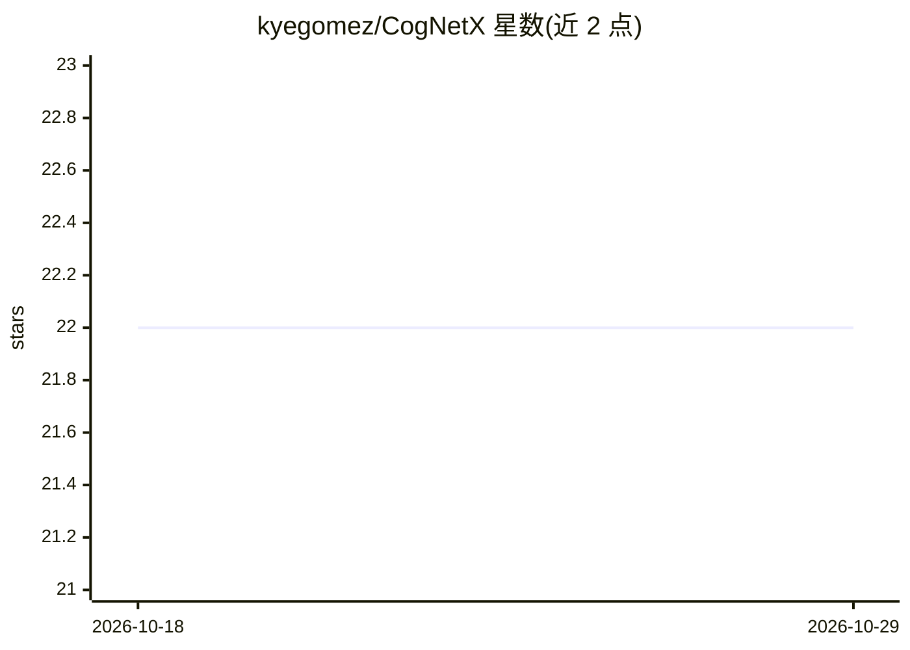

# kyegomez/CogNetX

⭐ 22 · Python · MIT · 推送 2026-10-26 · [GitHub](https://github.com/kyegomez/CogNetX) · [官网](https://discord.com/servers/agora-999382051935506503) · 个人维护

**受人类认知启发的多模态神经网络架构，融合语音/视觉/视频并生成文本**

基于 PyTorch 的多模态神经网络架构，模仿人类认知方式处理多种输入：用 Conformer 处理语音、ResNet50 处理图像、3D CNN（R3D-18）处理视频，Transformer 负责文本生成，将多模态特征融合后输出人类可读文本。架构设计为模块化，可扩展 EEG、触觉等模态（列为未来工作）。以 pip 包形式提供，附带示例脚本与训练脚本，面向构建多模态模型的研究者与开发者。

## 筛选速览

| 维度 | 判定 | 备注 |
|---|---|---|
| AI 角色 | `ai-native` | 本体是模型或模型工具 |
| 许可风险 | `permissive` | MIT |
| 部署形态 | `library` | 以包/库形式分发 |
| 模型依赖 | — | README 未给出锁定关系 |
| 硬件要求 | — | 无带数字的原话,不猜 |
| 安装摩擦 | `low` | 无编译、无系统依赖或容器化 |
| 成熟度 | — | 结构信号不足 |

## 能力要点

- 统一融合语音（Conformer）、视觉（ResNet50）、视频（R3D-18）与文本（Transformer）四种模态
- 基于 PyTorch 的模块化架构，支持扩展额外模态
- 提供 pip 安装、示例脚本（example.py）与训练脚本（train.py）

## 适用场景

- 构建将语音、图像、视频输入转换为文本输出的多模态模型
- 研究受人类认知启发的多模态融合架构
- 在自有数据集上训练或扩展多模态神经网络

## 场景标签

`多模态` `模型训练` · 领域:感知与多模态

## 证据(README 行号)

> L7: CogNetX is an advanced, multimodal neural network architecture inspired by human cognition. It integrates speech, vi
> L13: - **Text Generation**: Integrates a Transformer model to process and generate human-readable text, combining the fe

## 星数曲线

2026-10-18 22 → 2026-10-29 22（+0）

---
*卡片 v1 · prompt 1.4 · 生成 2026-10-27 · 置信度 high · 依据 README sha `ea5dc0dcaac1` · [字段定义](../../DATASET.md)*
